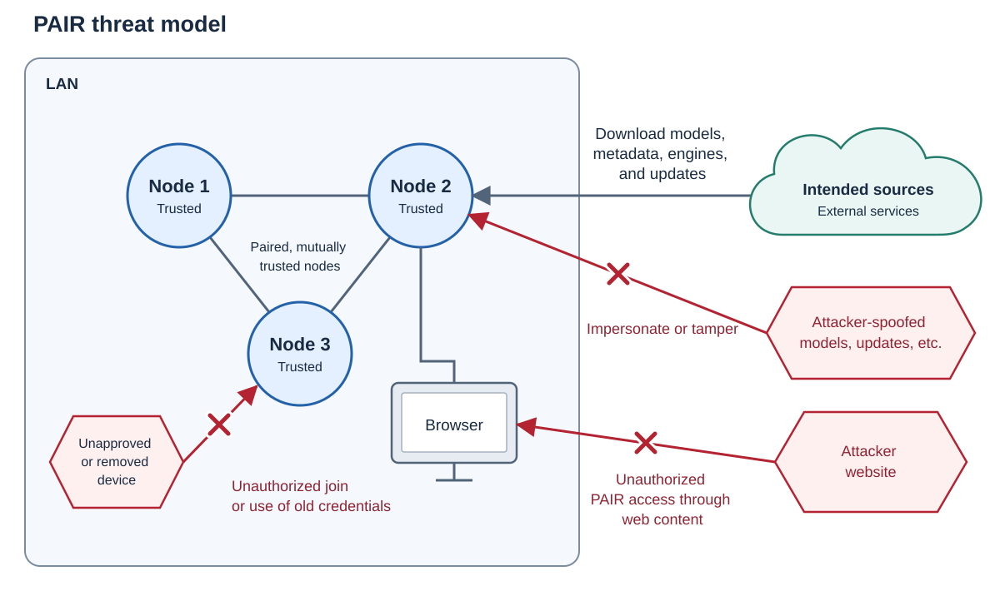

<!--
SPDX-FileCopyrightText: Copyright (c) 2026 NVIDIA CORPORATION & AFFILIATES. All rights reserved.
SPDX-License-Identifier: Apache-2.0
-->

# Security

NVIDIA is dedicated to the security and trust of its software products and
services, including NVIDIA PAIR.

**Do not report security vulnerabilities through public GitHub issues or pull requests.**
See below for the appropriate disclosure procedure.

## Threat model

PAIR connects mutually trusted nodes on a local network so applications can
use inference engines across a cluster. Pairing grants broad cluster authority,
including administration, engine operations, and introducing other members.
Discovery or access to the same network does not grant that authority.
Protected traffic between paired nodes is authenticated and encrypted.

The assets PAIR should protect include cluster membership and credentials,
inference requests and results, and the authority to use compute,
change settings, manage engines and models, or run commands on a node.

### Threats in scope

The following scenarios describe categories of attacks PAIR strives to defend against:

- **An unapproved device on the same network.** An attacker who gains access to the
  LAN, for example through Wi-Fi, *must not* be able to force a node into the cluster,
  use protected cluster operations, or read or tamper with protected traffic between nodes.
  PAIR's plaintext inference endpoints *must* accept requests only from the local machine.
- **A malicious website visited on a node.** User Ash opens an attacker-controlled
  website in a browser on a machine running PAIR. The website *must not* be able to use
  PAIR to run inference, read private results, or issue commands on the machine
  or cluster. Visiting the website must not itself authorize these operations.
- **Permissive parsing of untrusted data.** An attacker modifies metadata, a
  model name, or other content that PAIR processes during normal use. A parsing
  or rendering flaw *must not* let that content read private data, change settings,
  trick a user, or execute commands with PAIR's authority.
- **Substituted downloads.** Ash requests a genuine model download, engine
  installation, or PAIR update. An attacker impersonates the intended source,
  tampers with delivery, or redirects PAIR to a substituted artifact. PAIR's
  download and installation paths *must* preserve source authenticity and
  artifact integrity, including before executing downloaded software.
- **A former member using old credentials.** Ash removes a previously trusted
  node. After a remaining node processes that removal, the former member *must
  not* use the removed identity's credentials to authorize new protected
  operations on that node.
- **Sensitive content in logs.** PAIR’s own logs **must not** contain
  prompts, responses, pairing PINs, or private keys, only operational metadata.
  This is a general security best-practice and acts as defense-in-depth.

### Out of scope

- **Local users.** Users with OS accounts on cluster nodes are outside this threat model.
   For example, if Ash owns a PAIR cluster and Birch has an OS account on one of Ash’s nodes,
   protecting the cluster from Birch is outside PAIR’s scope. PAIR relies on OS permissions
   to protect each account’s files and credentials.
- **Compromised nodes.** An attacker who already controls a node through an
  attack outside PAIR is outside this model, as is a user deliberately pairing
  an attacker's node. Gaining control through a flaw in PAIR remains in scope.
- **Third-party behavior.** PAIR does not isolate engines from the rest of the
  machine or guarantee that model answers are safe or truthful. Applications
  using PAIR must defend against prompt injection and decide which actions their
  agents are allowed to perform.
- **Services exposed outside PAIR.** If Ash forwards a router port to an engine
  so anyone on the internet can reach it, Ash is responsible for securing that
  access. The same applies to a separate public proxy. PAIR remains responsible
  for the services it exposes and for blocking website attacks through its
  normal local interfaces.
- **Agent permissions and resource limits.** PAIR does not give each agent its
  own permissions or compute budget, or separate cluster users into different
  trust levels. An agent with engine API access may also manage models. The
  scheduler distributes work but does not guarantee availability when authorized
  clients submit too much work. Requests must still stay separate and go to the
  correct nodes.
- **Data destinations.** The node running inference and its trusted users can
  see the request and result. Engines, catalogs, updates, and applications may
  contact services outside the LAN. PAIR does not protect data after an
  application intentionally sends it elsewhere.
- **Removal limits.** Removing a node cannot erase data already copied or undo
  completed actions. Each node must learn about the removal before it can reject
  new requests from the removed node. Other approved identities must be removed
  separately.

### Known/Acceptable Limitations

- **Pairing bootstrap.** The six-digit PIN has low entropy and limited protection
  against active interception or manipulation during pairing. Pair trusted
  devices on a trusted network and check the displayed context. Later mutual TLS
  cannot repair trust granted to the wrong identity. Bypassing the pairing flow
  remains in scope.
- **Public LAN metadata.** Anyone on the same subnet can read a node's hostname,
  hardware inventory, and utilization without pairing. This information is sent
  over unencrypted HTTP. Reading it does not grant access to protected cluster
  operations.
- **Unpaired manual nodes.** The terminal UI has an option to find a node by address
  without pairing (`f`), and the proxy's service API can explicitly add an engine without
  pairing. Connections to an unpaired engine may use unencrypted HTTP, exposing
  inference traffic to interception or tampering.
- **Engine installs.** Some engine downloads have no expected checksum. PAIR uses
  HTTPS for those downloads, but does not independently check the downloaded
  file against a trusted hash.

## Report a vulnerability

**Do not report security vulnerabilities through public GitHub issues or pull
requests.** If someone discloses a potential vulnerability publicly, maintainers
may limit public discussion and redirect the reporter to a private channel.

Report a potential vulnerability in NVIDIA PAIR or another NVIDIA product through
one of these channels:

- Submit the [NVIDIA Vulnerability Disclosure Program form](https://www.nvidia.com/en-us/security/report-vulnerability/).
- Email [psirt@nvidia.com](mailto:psirt@nvidia.com). For encrypted email, use
  the [NVIDIA public PGP key](https://www.nvidia.com/en-us/security/pgp-key).
- If private vulnerability reporting is enabled for this repository, open the
  repository's **Security** tab and select **Report a vulnerability**.

Include the following details in the report:

- The affected version or commit
- The vulnerability class and, if applicable, the relevant in-scope scenario
- Reproduction steps
- A proof of concept, when available
- The expected impact

If the scope is unclear, describe the suspected boundary crossing in a private
report.

Remove unrelated personal information, credentials, private keys, tokens,
prompts, and model data from the report.

The NVIDIA Product Security Incident Response Team (PSIRT) triages submitted
reports. Refer to
[NVIDIA Product Security](https://www.nvidia.com/en-us/security/) for current
policies, bulletins, and disclosure information.
