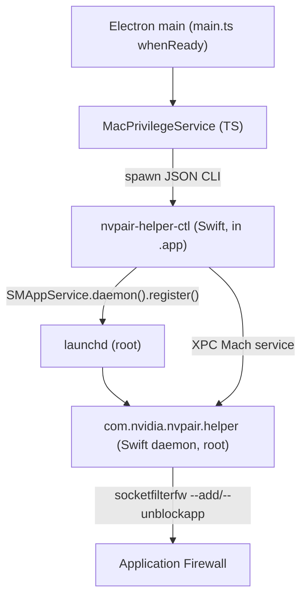

<!--
SPDX-FileCopyrightText: Copyright (c) 2026 NVIDIA CORPORATION & AFFILIATES. All rights reserved.
SPDX-License-Identifier: Apache-2.0
-->

# macOS Privileged Helper (SMAppService)

Personal AI Router ships as a drag-to-install `.dmg` on macOS. A `.dmg` has **no installer
step**, so adding the bundled networked binaries to the macOS Application
Firewall runs on **first launch** through an Apple
[`SMAppService`](https://developer.apple.com/documentation/servicemanagement/smappservice)
LaunchDaemon bundled inside the `.app`.

`minimumSystemVersion` is `13.0` because `SMAppService` requires macOS 13+.

## Components

| Component             | Path in `.app`                                                  | Language | Role                                                                                                                                         |
| --------------------- | --------------------------------------------------------------- | -------- | -------------------------------------------------------------------------------------------------------------------------------------------- |
| Daemon                | `Contents/MacOS/com.nvidia.nvpair.helper`                       | Swift    | Runs as **root** under launchd; vends a fixed XPC command surface; applies `socketfilterfw` rules.                                           |
| Control tool          | `Contents/MacOS/nvpair-helper-ctl`                              | Swift    | User-context CLI Electron spawns; registers/unregisters the daemon via `SMAppService`; relays XPC requests; prints one JSON object per call. |
| LaunchDaemon plist    | `Contents/Library/LaunchDaemons/com.nvidia.nvpair.helper.plist` | plist    | launchd config: `Label`, `BundleProgram`, `MachServices`, `AssociatedBundleIdentifiers`.                                                     |
| Shared protocol       | `native/Shared/HelperProtocol.swift`                            | Swift    | Compiled into **both** binaries so the XPC interface + security constants never drift.                                                       |
| `MacPrivilegeService` | `src/electron/services/mac-privilege-service.ts`                | TS       | UI-free wrapper; the only path Electron uses to drive the helper.                                                                            |
| Lifecycle wiring      | `src/electron/main.ts` (`runMacPrivilegedSetup`)                | TS       | First-run dialog + `ensureConfigured()` at `app.whenReady`; one-time gate in `ui-config.ts`.                                                 |

Both Mach-O binaries sit in `Contents/MacOS/` so the control tool's `Bundle.main`
resolves to the host `.app` (required by `SMAppService.daemon(plistName:)`).

## Runtime flow



`runMacPrivilegedSetup()` runs once per launch:

1. **First run only** — show an info dialog explaining macOS will ask to approve a
   background helper. A launch that starts hidden (the login item with **Start
   minimized to tray** on) has nobody to read it, so it checks
   `macPrivilege.status()` first. If the helper is already enabled, nothing left
   needs a person: it runs `ensureConfigured(true)` without any dialog and marks
   setup complete. Otherwise the first-run flow waits for the Overview window's first
   `show` (a tray or Dock click) and runs then, once. Only one setup run is ever in
   flight, so the deferred run cannot overlap a launch-time one, and it is skipped if
   that launch already completed setup. Once setup is complete, a hidden launch
   still runs step 2, which has no UI.
2. Call `macPrivilege.ensureConfigured(firstTime)`, which (no UI):
    - reads `nvpair-helper-ctl status`;
    - if enabled but unreachable, or the daemon version differs from the app
      version, attempt `uninstall` + `install` at most twice per app version,
      re-check `status`, and force a firewall reconfigure;
    - before the second replacement, wait 12 seconds for macOS to repair a stale
      launch constraint, then re-check status; skip replacement if the helper
      has recovered or now requires approval;
    - after unregistering, retry a failed registration at most twice, two seconds
      apart, only while both the registration result and current status report
      `notRegistered`; re-check status after each delay and stop retrying if it
      changes, including when approval is required;
    - if not registered, `install` (which calls `SMAppService.daemon().register()`);
    - when `enabled` and reachable with no known version mismatch, run
      `configure-firewall` (no `--app-path`: the daemon
      derives the target bundle from the verified caller — see Security).
3. On `requiresApproval`, the control tool calls
   `SMAppService.openSystemSettingsLoginItems()`; main surfaces guidance to
   enable the background item under **System Settings → General → Login Items &
   Extensions**, then relaunch.
4. On success (`enabled` + firewall configured), set the one-time
   `macHelperSetupComplete` flag in `ui-config.ts`. Clear it if setup fails or
   approval is pending so firewall configuration is retried on the next launch.

Before each replacement, PAIR persists `macHelperRepairAttemptVersion` and
`macHelperRepairAttemptCount` and clears `macHelperSetupComplete` in
`configs/ui-config.json`. Interrupted attempts count toward the two-attempt
limit. A saved version without a count represents one previous attempt. Pending
approval stops recovery; after approval, a subsequent launch can use any
remaining attempt. A new app version gets a new allowance.

This covers upgrades from 1.0.0 where signature rejection prevents reading a
daemon version. A correctly signed replacement can also be rejected by launchd
because its cached launch constraint still requires the old signing identifier.
In the reproduced failure, macOS invalidated that registration about 10 seconds
after rejecting the launch, but another unregister/register cycle was needed to
bind the replacement record. The 12-second wait allows that observed repair
window to elapse; it is not a macOS timing guarantee. If two attempts fail, setup
stays incomplete and subsequent launches do not repeat replacement for the same
version. Registration alone never implies successful XPC communication.

macOS can also reject registration immediately after a successful asynchronous
unregister, even though its API promises that re-registration is safe after the
completion callback. [Apple DTS acknowledges this behavior as a bug](https://developer.apple.com/forums/thread/783539).
The bounded registration retries allow that transition to settle without another
unregister or consuming another replacement attempt. The delay is a workaround,
not a macOS timing guarantee; persistent errors still leave setup incomplete.

The firewall is reconfigured on first run, after a version refresh, and after a
fresh registration (so a release that adds a networked binary still gets its
rule); otherwise the idempotent `socketfilterfw` work is skipped to keep launches
cheap.

## Manual recovery

If automatic repair fails or its two attempts have been exhausted, re-register
the helper manually. This does not require deleting PAIR's app data or resetting
the saved repair counter.

1. Fully quit PAIR using **Quit** in its menu bar menu; closing the window is not
   enough. Keep the current signed app installed in `/Applications`.
2. In Terminal, run these commands one at a time as your normal macOS user,
   without `sudo`:

   ```bash
   "/Applications/NVIDIA PAIR.app/Contents/MacOS/nvpair-helper-ctl" uninstall
   "/Applications/NVIDIA PAIR.app/Contents/MacOS/nvpair-helper-ctl" install
   ```

   The `uninstall` command unregisters the helper; it does not remove PAIR or
   its models and settings. If either command reports an error, stop and keep
   its output for troubleshooting. If registration reports `Operation not
   permitted` immediately after a successful uninstall, wait a few seconds and
   retry `install` once, as described in the asynchronous-unregister limitation
   above.
3. If macOS requests approval, enable **NVIDIA PAIR** under **System Settings →
   General → Login Items & Extensions**.
4. Check communication before reopening PAIR:

   ```bash
   "/Applications/NVIDIA PAIR.app/Contents/MacOS/nvpair-helper-ctl" status
   ```

   Require `registration: "enabled"`, `reachable: true`, and a `daemonVersion`
   matching `ctlVersion`. Then run:

   ```bash
   "/Applications/NVIDIA PAIR.app/Contents/MacOS/nvpair-helper-ctl" configure-firewall
   ```

   Require JSON `ok: true`, then reopen PAIR and complete setup if prompted.
   Quit and reopen it again to confirm the setup warning no longer appears.

If the helper remains unreachable or a command keeps failing, retain the command
output and app/build version for a bug report, following
[Collecting logs](../../docs/log-collection.mdx). Do not clear all app data or
weaken the signing requirements to work around the failure.

## XPC command surface

`PAIRHelperProtocol` (`native/Shared/HelperProtocol.swift`) is the entire surface
— there is **no arbitrary shell**:

| Method                       | Action                                                                                                                                 |
| ---------------------------- | -------------------------------------------------------------------------------------------------------------------------------------- |
| `getVersion`                 | Returns the daemon build version (stamped to equal the app version).                                                                   |
| `configureFirewall(appPath)` | `--add` + `--unblockapp` each bundled networked binary. `appPath` is ignored — the daemon derives the bundle from the verified caller. |
| `removeFirewall(appPath)`    | `--remove` each bundled networked binary. `appPath` ignored.                                                                           |

### Networked binaries (firewall set)

The daemon adds rules only for cli-bin binaries that open a listening socket.
Stdio-only or client-only binaries (`nvpair-node-settings`,
`nvpair-manual-nodes`, `nvpair-job-scheduler`, `nvpair-ui-broker`) get no rule.
The set in `native/PrivilegedHelper/main.swift` must stay in sync with the
`needsFirewallAccess` metadata in `MODULAR_RUNTIME_BINARIES`
(`src/shared/constants/modular-binaries.ts`) and the manual uninstaller.
`npm run service-contracts:check` fails when the Swift list differs from that canonical set:

`nvpair-proxy`, `nvpair-node-info`, `nvpair-node-scanner`,
`nvpair-workload-manager`, `nvpair-errors`, `nvpair-cluster-manager`,
`nvpair-engine-manager`.

> These seven mirror the per-program/per-port `netsh` rules in
> `scripts/build/installer.nsh` on Windows. macOS's Application Firewall is
> per-application and inbound-only, so one `--add`/`--unblockapp` per binary
> collapses Windows's per-port rules.

## Security

Code-signing requirements are pinned (constants in `HelperProtocol.swift`, Team
ID `6KR3T733EC`). Each shares a common `developerIdAnchor`: `anchor apple
generic` **plus** the Developer ID intermediate marker
(`certificate 1[field.1.2.840.113635.100.6.2.6]`), the Developer ID Application
leaf marker (`certificate leaf[field.1.2.840.113635.100.6.1.13]`), and the Team
ID OU. Pinning the Developer ID markers (not just `anchor apple generic` + OU)
prevents any Apple-anchored cert under the same Team ID from satisfying the
requirement.

- **`ctlCodeSigningRequirement`** — `identifier "nvpair-helper-ctl" and
<developerIdAnchor>`. The daemon pins this on every **inbound** XPC connection
  (`setCodeSigningRequirement`), so only the control tool — pinned by signing
  identifier, not merely Team ID — can drive privileged ops.
- **`daemonCodeSigningRequirement`** — `identifier "com.nvidia.nvpair.helper" and
<developerIdAnchor>`. The control tool pins this on its **outbound** connection
  so a hijacked Mach service name cannot answer.
- **`appCodeSigningRequirement`** — `identifier
"com.nvidia.nvpair" and <developerIdAnchor>`, used to
  re-verify the target bundle.

**Confused-deputy fix.** The daemon no longer trusts an `--app-path` argument.
It derives the target bundle from the **verified identity of the connecting
process**: it resolves the caller's `SecCode` from its PID, checks it against
`ctlCodeSigningRequirement`, and reads the control tool's own path — the `.app`
is its grandparent-of-`Contents/MacOS`. A caller can therefore only ever
configure **its own** bundle, never point the daemon at an arbitrary
NVIDIA-signed `.app`.

**TOCTOU / symlink hardening.** Before mutating firewall state the daemon
re-validates the derived bundle: reject path traversal, reject a symlinked
`.app` / `cli-bin` (final component opened with `O_NOFOLLOW`), reject
group/other-writable ancestor directories, and verify the bundle signature
against `appCodeSigningRequirement`. Immediately before each `socketfilterfw`
invocation it re-opens the individual binary with `O_NOFOLLOW` and re-verifies
that binary's own NVIDIA signature, and it now **fails** (rather than ignoring)
any non-zero `socketfilterfw` exit.

## Build & signing

- `scripts/build/macos/build-helper.ts` compiles both binaries with `swiftc` via
  `xcrun` for `arm64` + `x86_64`, then `lipo`s them into universal Mach-Os under
  `native/build/`. It also generates `HelperVersion.swift` from `package.json`.
  Wired as a `prebuild` for `build:electron:mac:{x64,arm64}` in `package.json`.
- `electron-builder.config.ts` bundles the binaries + plist via `mac.extraFiles`.
- Official (signed) builds sign each helper binary individually with hardened
  runtime **before** the app, alongside the modular binaries. The public build
  is unsigned.
- macOS packaging requires `swiftc`; build environments should verify it with
  `xcrun --find swiftc`.

The daemon embeds `native/PrivilegedHelper/Info.plist` in `__TEXT,__info_plist`
in both architectures. Its `CFBundleIdentifier` supplies the signing identifier
even when a signing service re-signs the enclosing app recursively. Without it,
the filename-derived default can strip `.helper` and produce `com.nvidia.nvpair`.
The control tool must continue using the enclosing app's `Bundle.main` for
ServiceManagement; it does not embed a helper-specific Info.plist.

On macOS, check the built daemon's identifier through standalone and recursive
ad hoc signing of disposable copies:

```bash
npm run build:helper:mac
npm run test:helper-signing:mac
```

This regression test checks identifier stability in every architecture, not
Developer ID trust. It does not run or register the copied daemon.

### Required release validation

The signing identifiers of the loose helper executables are part of the XPC
authentication contract:

| Executable | Required signing identifier |
| --- | --- |
| `Contents/MacOS/com.nvidia.nvpair.helper` | `com.nvidia.nvpair.helper` |
| `Contents/MacOS/nvpair-helper-ctl` | `nvpair-helper-ctl` |
| Host application | `com.nvidia.nvpair` |

The release signer must assign each helper its own identifier, retain hardened
runtime and NVIDIA's Developer ID Application signature, and sign the enclosing
app after signing its nested executables. It must not overwrite the daemon's
identifier with the host app's identifier during a later signing pass.
Pass `--identifier com.nvidia.nvpair.helper` when signing the daemon and
`--identifier nvpair-helper-ctl` when signing the control tool (or the signing
service's equivalent). Do not rely on filename-derived defaults: `codesign`
can strip `.helper` from the daemon's filename and produce the app's identifier.
An explicit identifier in an earlier signature is insufficient if a later
signing pass derives a new default.

After the **final** app signing pass, before notarization or creating release
archives, the signed release pipeline must run this command from `desktop/`
and fail the build if it exits nonzero:

```bash
npm run verify:helper-signatures:mac -- "/path/to/NVIDIA PAIR.app"
```

The command compiles a temporary validator with the same `HelperProtocol.swift`
used by both helpers. It verifies each helper and the app against their complete
pinned requirements with `codesign --verify --strict --all-architectures`.
It does not register the helper, modify signatures, or change firewall rules.
Unsigned public builds are expected to fail this release check.

Release maintainers must integrate this check into the signing pipeline after
the final signing pass; adding the validator to the source tree does not wire
it into release signing. The public build remains unsigned. Run the check again
against the app extracted from each final DMG and ZIP before publishing.
General app signature verification
alone is insufficient: a valid NVIDIA signature can still have an identifier
that the XPC peer rejects, as reported in
[issue #175](https://github.com/NVIDIA/Personal-AI-Router/issues/175).

### Signed-build acceptance checks

Use a signed release candidate on a test Mac, including an upgrade from the
affected release. Install in `/Applications`, launch PAIR as the normal user,
and approve its background helper if prompted. Do not re-sign the installed
app or alter the pinned requirements to make these checks pass.

For upgrade coverage, first confirm the affected release reports `enabled` but
`reachable: false`, then replace the app in place without unregistering the old
helper or clearing user data. On the updated app's first launch, confirm it
re-registers the helper and records the new app version in
`macHelperRepairAttemptVersion` and `macHelperRepairAttemptCount`. Follow the
checks below after any required approval. Exercise both approval during initial
registration and approval followed by relaunch. If the first replacement stays
unreachable, confirm a delayed second attempt. If both attempts fail, verify
setup remains incomplete and relaunching the same version does not trigger
another unregister/register cycle.

1. Run the release validation command above against the installed app.
2. Run `"/Applications/NVIDIA PAIR.app/Contents/MacOS/nvpair-helper-ctl" status`.
   Require `registration: "enabled"`, `reachable: true`, and a `daemonVersion`
   matching `ctlVersion` and the app version. The command's exit status alone
   does not prove reachability.
3. Run `"/Applications/NVIDIA PAIR.app/Contents/MacOS/nvpair-helper-ctl" configure-firewall`.
   This changes firewall rules; require exit zero and JSON `ok: true`.
   Check each of the seven networked binaries listed above with
   `/usr/libexec/ApplicationFirewall/socketfilterfw --getappblocked <binary-path>`.
4. Confirm normal app setup writes `macHelperSetupComplete: true` in the
   app's user-data `configs/ui-config.json`. Do not set the flag manually.
5. Fully quit and reopen PAIR twice. Confirm the flag remains true, the helper
   stays reachable, and no helper-authorization dialog returns. Repeat after
   a reboot. Closing only the window leaves PAIR running in the tray.

Record the app/build version, macOS version, architecture, command results,
and whether this was a clean install or an upgrade. A running launchd job or
the Service page's Running state is not evidence of helper XPC reachability.

## Uninstall

`scripts/build/macos/uninstall.sh` (shipped at
`Contents/Resources/installer-tools/uninstall-macos.sh`) unregisters the daemon
via `nvpair-helper-ctl uninstall` **before** removing the app, while the control
tool still exists. `SMAppService` state is tied to the real user's session, so
when invoked via `sudo` the tool is run as the invoking user. A
missing/unregistered daemon is ignored (best-effort).

## Open risks

- SMAppService daemon approval UX varies across macOS 13.x (inline prompt vs
  System Settings → Login Items).
- Release signing must preserve each helper binary's hardened runtime and
  signature; verify each binary after signing.
