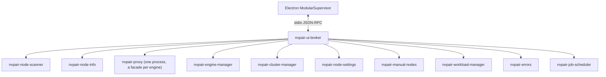

<!--
SPDX-FileCopyrightText: Copyright (c) 2026 NVIDIA CORPORATION & AFFILIATES. All rights reserved.
SPDX-License-Identifier: Apache-2.0
-->

# Services Backend Integration

The `services/` tree is Personal AI Router's backend and the source of truth for
service behavior. It lives as a sibling directory in this monorepo, and Personal
AI Router builds its bundled binaries directly from that source.

Personal AI Router does not reimplement backend behavior in TypeScript. Electron main owns
process startup, translates JSON-RPC into the stable frontend contract, and
projects backend notifications into renderer state.

## Runtime ownership

`nvpair-ui-broker` is the only backend process Electron starts directly. The
broker supervises every worker and relays its control plane.

| Binary                    | Runtime role                                              |
| ------------------------- | --------------------------------------------------------- |
| `nvpair-ui-broker`        | Worker supervision and relay                              |
| `nvpair-proxy`            | Engine routing proxy with cluster-mTLS ingress; one process hosting a facade per enabled engine |
| `nvpair-node-scanner`     | Discovery and node announcement                           |
| `nvpair-node-info`        | Node metadata and telemetry                               |
| `nvpair-manual-nodes`     | User-managed node entries                                 |
| `nvpair-workload-manager` | Workload replication                                      |
| `nvpair-errors`           | Error registry and peer sync                              |
| `nvpair-node-settings`    | Persisted node settings                                   |
| `nvpair-engine-manager`   | Engine lifecycle and model operations                     |
| `nvpair-cluster-manager`  | Pairing, trust, and membership                            |
| `nvpair-job-scheduler`    | Node-wide routing priority                                |
| `nvpair-tui`              | Bundled standalone terminal client                        |

The runtime inventory and ownership flags live in
`src/shared/constants/modular-binaries.ts`. Product and component versions live
only in `services/versions.json` and are rendered into `docs/services-api.md` by
`service-contracts:write` — do not restate version numbers in this document.



Optional workers are non-fatal at runtime, but a normal build produces every
binary from the `services/` source.

## Electron integration

The main integration points are:

| Responsibility                                                     | File                                                 |
| ------------------------------------------------------------------ | ---------------------------------------------------- |
| Process startup, broker flags, subscriptions, notification routing | `src/electron/service-bridge/modular-supervisor.ts`  |
| JSON-RPC stdio framing                                             | `src/electron/service-bridge/json-rpc-subprocess.ts` |
| Logical invoke handlers                                            | `src/electron/service-bridge/empty-handlers.ts`      |
| Node, engine, workload, and error projection                       | `src/electron/service-bridge/modular-state.ts`       |
| Broker hardware snapshot and push projection                      | `src/electron/service-bridge/modular-state.ts`       |
| Runtime binary inventory                                           | `src/shared/constants/modular-binaries.ts`           |
| Backend-coupled defaults                                           | `src/shared/constants/modular-runtime.ts`            |
| Frontend channel contract                                          | `src/shared/types/ws-channels.ts`                    |

After the broker emits `app:ready`, Electron subscribes to discovery, proxy,
engine, workload, cluster, and error relays. The bridge then emits renderer push
events from backend notifications.

Connector readiness follows the broker contract: `app:ready` establishes the
service connection, while per-engine proxy readiness remains an
asynchronous capability signal. Personal AI Router waits up to the canonical
startup deadline in `src/shared/constants/modular-runtime.ts` for
`app:ready`; an outright failure or stalled broker startup is surfaced in
Settings > Service with retry and log access. If a stalled broker reports ready
later, the connector transitions to connected without spawning a second broker.

### Node hardware

Electron and TUI receive full hardware in broker `AvailableNode.info` snapshots
and `discovery:node-info` updates. Electron projects CPU, memory, GPU, and VRAM
into renderer node state and `metrics:update`. Broker workers own local IPC
collection, pinned-mTLS peer reads, address failover, retry policy, and separate
public HTTP previews for unverified discoveries or manual configurations.

Hardware must match the current discovery record and verification. Public
preview identity and registry claims are stripped, and previews cannot enter
verified inventory, routing, liveness, or scheduling. The broker caches each
source with its receipt time, preserves sample age on query/replay, and clears
hardware when its source or proof is invalidated. Internal scheduling snapshots
omit the full display payload and use only accepted compact GPU telemetry.
Private node-info-to-broker-to-scanner frames carry a local capture time so GPU
age includes blocked pipe delivery as well as queue and cache time. This remains
internal to the services and does not change the desktop's hardware payload.
`info.observedAt` records local receipt of the whole display observation,
independently of GPU sample age. Manual hardware retains the time assigned by
the owned manual worker; other observations are stamped by the broker. Snapshots
and pushes preserve it. Electron uses it directly for metrics deduplication,
keeps measurement updates separate from structural node changes, and never
reconstructs observation time from GPU sample age.

Scanner supplies identity, addresses, and models for hosts also tracked by manual
configuration. If scanner hardware is missing, the broker may display manual
hardware when both records are trusted and share the same pinned host identity
and verification ID. Choosing that sample preserves its age and does not change
scheduling inputs.

Service control flows through broker JSON-RPC. Engine proxy HTTP is reserved
for inference clients. The node-info public HTTP listener serves unpaired
previews collected by services.

## Current domain routing

| Backend notification                                 | Personal AI Router handling                                                                                                     | Renderer push                                             |
| ---------------------------------------------------- | ------------------------------------------------------------------------------------------------------------------------------- | --------------------------------------------------------- |
| `app:ready`                                          | Complete broker startup and refresh snapshots                                                                                   | `state:request-refresh`                                   |
| `discovery:nodes-changed`                            | Replace discovery snapshot and diff nodes                                                                                       | `discovery:nodes-changed`, `nodes:upsert`, `nodes:remove` |
| `ollama-proxy:ready` / `lmstudio-proxy:ready` / `llamacpp-proxy:ready` / `vllm-proxy:ready` | Record engine proxy port                                                                                          | `engines:state-changed`                                   |
| proxy `node/*`                                       | Update per-engine node presence; the advertised port is the peer's promoted proxy port (not the engine's private loopback port) | node and engine pushes                                    |
| `engine:ready` / `engine:state-changed`              | Update engine facts and models                                                                                                  | `engines:state-changed`                                   |
| `engine:settings-changed`                            | Validate and republish the owning node's settings snapshot                                                                      | `engines:settings-changed`                                |
| `engine:install-progress` / `engine:remote-progress` | Update operation progress                                                                                                       | engine progress pushes                                    |
| `errors:update`                                      | Replace the error snapshot                                                                                                      | `errors:update`                                           |
| `cluster:invite-received`                            | Parse inbound invite                                                                                                            | `cluster:invite-received`                                 |
| `cluster:invite-canceled` / `cluster:invite-expired` | Prune the canceled or timed-out inbound invite from the authoritative set                                                       | `cluster:pending-invites-changed`                         |
| `cluster:identity-changed`                           | Persist local identity                                                                                                          | `connection:cluster-identity`                             |
| `nodes:changed`                                      | Replace membership snapshot                                                                                                     | `nodes:changed`                                           |
| `workloads:upsert` / `workloads:remove`              | Update workload catalog                                                                                                         | workload pushes                                           |

`nvpair-job-scheduler` combines queued and running work across all engines with
a smoothed 0–3 pressure from the busiest GPU. Invalid, missing, or
older-than-10-second telemetry receives neutral pressure. It emits
`schedule:priority` with order, pending count, and pressure; the broker applies
each snapshot to the matching proxy through `node/set-priority`
(generation-ordered so a stale async call cannot overwrite a newer snapshot,
and re-pushed when a proxy respawns). Each proxy atomically minimizes
`pending + gpuPressure + localReservations`, so simultaneous requests account
for one another before workload feedback arrives. None of this internal
scheduling traffic is forwarded to Personal AI Router.

## Engine lifecycle behavior

`nvpair-engine-manager` owns installed/running state, persisted engine ports,
model operations, and desired engine state across app restarts.

The backend emits terminal lifecycle state and install progress. Personal AI Router maintains
one centralized pending-action layer so controls respond immediately while
waiting for authoritative state. Pending state clears on matching engine state,
progress, or error pushes.

Local engine operations include install, start, stop, uninstall, update, port
changes, and model actions. Remote cluster operations use the engine manager's
remote control surface where supported.

### Engine settings

Ports and the engine arguments are one authoritative, revisioned record owned by
the node running the engine. The broker exposes `engine:{get,preview,apply}-settings`
and relays a request naming another node to that peer's engine manager, so a
clustered device is edited like the local one. Preview validates without
persisting or starting anything; apply journals the accepted revision, then
stops, rebinds the proxy, and restarts as needed, and returns only an
acknowledgement — the outcome arrives as an `engine:settings-changed`
notification, which Personal AI Router republishes as `engines:settings-changed`.
A revision mismatch is rejected rather than merged, and an operation interrupted
by a crash is recovered from the journal at the next startup.

`engine:configure-launch` is refused at the broker's client surface with
`-32601`: reaching the engine manager directly would skip the journal, the port
reservation, and the proxy rebind that apply owns. `engine:set-port` is the
port-only entry point the TUI uses; the broker intercepts it and runs the same
authoritative operation rather than forwarding it, so both callers validate,
restart, and persist identically.

Launch arguments and environment values pass through literally without an
engine-option catalog. Only managed networking and CORS are semantically
validated. Managed CORS origin-list and boolean-control changes must originate on the owning node; other
environment assignments can also be changed by a pinned peer.

`engine:stop` (and its cluster `ec` equivalent) reclaims an orphan a prior run
left on the engine's own managed port, terminating it only when that PID is
running the binary NVPAIR manages. A genuinely foreign listener on a different
port is declined with an actionable error, but the user's OFF intent is still
persisted. Personal AI Router therefore treats the saved desired state as authoritative and
surfaces a stop error as guidance, not as proof the OFF choice was lost.

Stopping a managed engine is bounded. On Unix, engine-manager sends SIGTERM to
the owned process group, waits the manifest's `stop.grace_s` (five seconds by
default), then escalates to SIGKILL; `signal:"kill"` skips the grace. Failed
startup cleanup and orphan reclaim use the same stop policy. On Windows,
windowless managed engines cannot receive a graceful (non-`/F`) close, so
stopping uses immediate `taskkill /T /F`.

Shutdown ordering belongs to the broker. Personal AI Router sends the broker `shutdown` and
does not stop the engines itself. The broker stops the proxy first, so no new
inference arrives, then calls `engine:prepare-shutdown` before tearing down its
workers, which stops local engine processes without clearing their persisted
desired state, so engines are not orphaned. The broker then joins its workers
concurrently within one shared teardown budget. A worker that misses its grace
is terminated and then killed, except engine-manager on Windows, whose join is
abandoned rather than killed mid-stop. The broker restores enabled engines on
the next startup.

## Discovery and models

`nvpair-node-scanner` is the discovery authority. Broker
`AvailableNode` snapshots provide the stable per-host UUID (`hostUuid`), canonical
addresses, the `trusted` and `clustered` flags, model inventory, and per-engine
model attribution.

Personal AI Router keys local and verified nodes by `hostUuid`, the identity the
services stamp on workloads (`originatedFrom`/`scheduledOn`), errors (`nodeId`),
proxy routing (`Node.ID`), and cluster membership (`ClusterNode.nodeUuid`).
Unverified discoveries use their independent `discoveryRecordId` as their key.
Hostnames are display names. A public hardware preview cannot merge an
unverified discovery into a local or verified node.

Local model state comes from `nvpair-engine-manager`; remote model state comes
from scanner enrichment of each peer's engine-manager `/v1/models` endpoint.
Scanner clears a peer's model inventories when its authenticated proof or
engine-manager endpoint changes or disappears. An available replacement endpoint
triggers a refresh. Temporary failures at an unchanged source retain its last
successful inventory.

### When the backend drops a node

Scanner scans mDNS every five seconds and expires a discovery after twelve
consecutive misses. When several known nodes disappear together, up to six
empty scans receive a local-reception grace period. Expiry clears the observation
and its candidate caches independently of verified peer availability.

The pinned-mTLS sampling loop refreshes inventory independently of mDNS.
After a peer's final discovery expires, its verified record is retained while
authenticated inventory or inference activity is less than a minute old.
Engine facades report inference response bytes through `node/activity`, which
the broker relays as `discovery:node-activity`. Availability expiry removes the
verified record and measurements; membership and pins are owned by cluster-manager.

Ordinary announcement updates do not republish an observation already represented
by a verified peer with the same current proof. Trust withdrawal removes the
verified record and restores known observations as unverified pairing candidates.

Eviction is a strong claim, not a guess: it is what fails the in-flight workloads
pinned to that node (`node <name> went offline`). Personal AI Router consumes the
result through the discovery snapshot and must not add a second, shorter
reachability verdict of its own. Failed hardware collection leaves the last
accepted sample aging and never independently marks a node offline.

The model catalogue is backend-owned. `nvpair-engine-manager` serves the curated
Ollama, LM Studio, and llama.cpp lists over `engine:catalog`, filtered for the
operating system and CPU a model will install on; Electron relays the call and
maps rows for the renderer, which then sends pull-ready model IDs back through
the engine manager. llama.cpp's source is also searchable: the relay passes the
model hub's query through, and the engine manager searches Hugging Face with it.
The Ollama reply is a single multi-megabyte frame, so every hop on its path
shares `jsonrpc.WorkerFrameBytes`.

## Pairing and security

`nvpair-cluster-manager` owns node identity, PIN pairing, trusted certificates,
membership, and removal. Personal AI Router implements no cluster cryptography or transport
security.

Personal AI Router:

- starts and responds to pairing sessions;
- displays the inviter's six-digit PIN;
- cancels an in-flight outbound invite through `cluster:cancel-invite` (the
  backend invalidates the PIN and best-effort notifies the joiner, which reflects
  it via the consumed `cluster:invite-canceled` push);
- dismisses the receiver's PIN prompt when an unanswered invite times out — the
  backend expires inbound invites and pushes `cluster:invite-expired`, which
  Personal AI Router consumes to prune the pending invite;
- surfaces a `rejected` invite reason (notably `already-clustered`) and disables
  inviting a discovered node the broker reports as already `clustered`;
- persists identity changes through `nvpair-node-settings`;
- renders membership from `nodes:changed`.

Cluster membership correlates by `ClusterNode.nodeUuid` — the stable per-host
UUID that also keys discovery, workloads, errors, and `selfId` — never the
hostname (`ClusterNode.id`, which is display only). `nodes:remove` is sent the
UUID (self-removal routes to `cluster:leave`). For manual-node removal, the
bridge sends the broker `node/remove {nodeId}`, which resolves the node key to
the worker's exact configured entry ID. A matching entry name cannot select a
different node configuration.

### Secure inference (backend-owned)

An NVPAIR-launched engine binds to loopback only and is never directly
LAN-reachable. Each node fronts all of its engines with one `nvpair-proxy`
process, and every facade's LAN ingress is gated by cluster mTLS: only a pinned
cluster member can send it work. Discovery advertises the promoted **proxy**
port (never the engine port), and the broker hands the private loopback engine to
the local proxy via `node/set-local-backend`. Every cluster-scoped worker derives
its own membership from the cluster directory continuously, so a proxy's mTLS
ingress tracks a create, join, or leave with no worker restart. Loopback
plaintext requests from local clients are unaffected. This is entirely
backend-owned; Personal AI Router only reflects the advertised proxy port and does not
implement any of the transport security.

## Building binaries

```bash
npm run build:modular-binaries
```

`scripts/build-modular-binaries.ts`:

1. validates the backend source and Go toolchain;
2. clears stale `cli-bin/` content;
3. cross-compiles every shipped component for the selected target;
4. stamps component versions from `versions.json`;
5. writes `cli-bin/manifest.json` with source fingerprint, target, versions, and hashes.

The build is cache-aware. CI passes `--force`. Packaging validates that
`cli-bin/` contains only the expected binaries and manifest.

## Contract artifacts

- `docs/service-contract-exceptions.json` records intentional ignored methods.
- `docs/services-api.md` is generated from `services/` Go source and records the
  current JSON-RPC method surface.
- `docs/services-parity.md` records current domain capability status without
  release history.

## Updating the backend

1. Change the backend source deliberately. The backend is the sibling
   `services/` tree in this monorepo. After edits, report drift from
   `desktop/`:

    ```bash
    npm run service-contracts
    ```

2. Review component version changes, emitted notifications, handled requests,
   and new binary components, then regenerate `docs/services-api.md` with
   `service-contracts:write`. Declare bumps for the affected components in the
   pull request's `pair-release-intent:v1` block as `services/VERSIONING.md`
   describes; `services/versions.json` is written by automation and CI rejects
   a hand edit. Do not
   hardcode product or component versions in this document or
   `docs/services-parity.md` — `service-contracts:check` fails if they appear.
3. Read the changed backend `README.md` / `spec.md` and the Go implementation.
4. Update Personal AI Router's runtime inventory, broker flags, handlers, state projection,
   frontend contracts, and current documentation as required.
5. Resolve every missing notification with a real consumer or a documented
   `ignoredMethods` reason in `service-contract-exceptions.json`.
6. Regenerate the API doc when RPC surfaces changed:

    ```bash
    npm run service-contracts:write
    ```

7. Verify:

    ```bash
    npm run service-contracts:check
    npm run build:modular-binaries -- --force
    npm run typecheck
    ```

8. Commit the `services/` change, the generated backend API surface, parity
   status, and integration changes together.

## Integration rules

- Edit the backend under `services/`; do not add a backend checkout inside
  `desktop/`.
- Do not run a worker from Electron and the broker simultaneously.
- Do not duplicate backend behavior in the renderer.
- Do not add alternate compatibility paths for old backend layouts.
- Treat `ws-channels.ts` as the renderer contract and backend JSON-RPC as an
  implementation detail of Electron main.
- Verify notification payload fields, not only method names.
