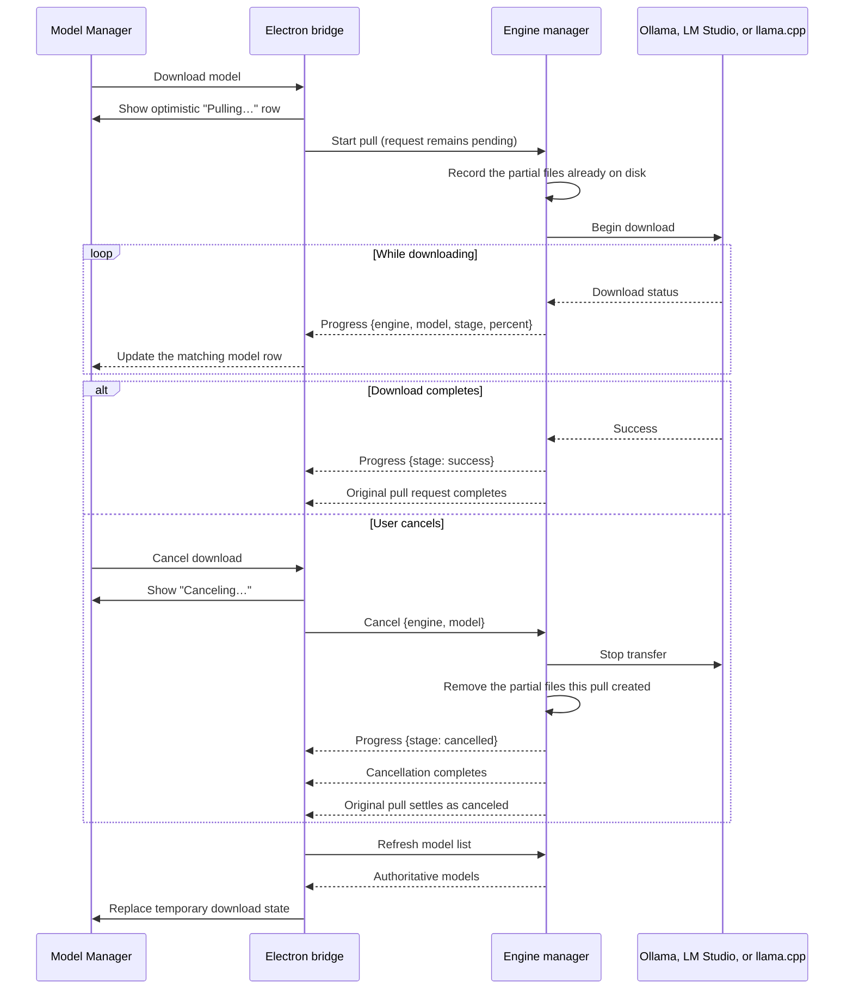
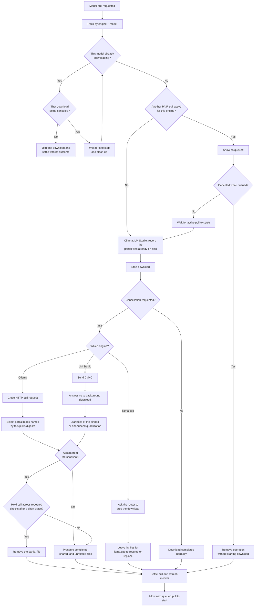

<!--
SPDX-FileCopyrightText: Copyright (c) 2026 NVIDIA CORPORATION & AFFILIATES. All rights reserved.
SPDX-License-Identifier: Apache-2.0
-->

# Services Capability Status

This document records the current integration status between Personal AI Router
and the `services/` backend. It is a present-state reference, not a release
history.

- Backend versions: `services/versions.json` (rendered in `docs/services-api.md`)
- Method-level contract: `docs/services-api.md`
- Exceptions: `docs/service-contract-exceptions.json`
- Integration runbook: `docs/services-backend.md`

## Status summary

| Domain                     | Status                          | Current state                                                                                                                                                                                                                            |
| -------------------------- | ------------------------------- | ---------------------------------------------------------------------------------------------------------------------------------------------------------------------------------------------------------------------------------------- |
| Process supervision        | Complete                        | Electron starts only `nvpair-ui-broker`; the broker supervises all workers                                                                                                                                                               |
| Discovery                  | Complete                        | Broker discovery snapshots drive available nodes and node state                                                                                                                                                                          |
| Node telemetry             | Integrated with direct poll     | Electron polls advertised `/v1/node-info` (plain HTTP); remote OS and some remote telemetry are backend-limited                                                                                                                          |
| Manual nodes               | Complete with local persistence | Broker owns probing, durable entries, restart replay, and proxy registration                                                                                                                                                             |
| Ollama routing             | Complete                        | Broker relay and backend scheduler drive proxy routing                                                                                                                                                                                   |
| LM Studio routing          | Complete                        | Parallel broker relay and scheduler path                                                                                                                                                                                                 |
| llama.cpp backend          | Integrated                      | Desktop and TUI expose install, lifecycle, catalog pull, inventory, load/unload, endpoints, routing, and demo traffic                                                                                                                    |
| vLLM engine                | Integrated (Linux, macOS arm64) | Desktop and TUI expose install, lifecycle, the cached-model list, switching the served model (Load), Hugging Face catalog search and download, endpoints and routing; eject (stops the engine), delete of cached models; no demo traffic |
| Local engine lifecycle     | Complete                        | Install, start, stop, uninstall, update, and port configuration                                                                                                                                                                          |
| Remote engine lifecycle    | Partial                         | Remote install, start, stop, status, and model pull are supported                                                                                                                                                                        |
| Engine models              | Partial                         | Core list, pull, load, unload, and supported delete actions are wired                                                                                                                                                                    |
| Engine version metadata    | Backend-limited                 | The backend status surface does not provide a complete version/install-owner/update contract                                                                                                                                             |
| Errors                     | Complete                        | Broker-relayed registry with peer synchronization                                                                                                                                                                                        |
| Workloads                  | Complete after subscription     | Local and peer workload events feed one Electron catalog                                                                                                                                                                                 |
| Cluster pairing            | Complete                        | PIN pairing, identity, membership, leave, and removal                                                                                                                                                                                    |
| Cluster transport security | Backend-owned                   | Node-to-node transport security, including the proxies' cluster-mTLS inference ingress, is entirely backend; Personal AI Router implements none                                                                                          |
| Settings                   | Partial                         | Cluster identity plus per-engine ports and engine arguments, local and remote; inert backend settings are not surfaced                                                                                                                   |
| Model catalog search       | Backend-owned                   | `engine:catalog` serves the locked Ollama list and the cached LM Studio and llama.cpp catalogs, and searches Hugging Face for llama.cpp                                                                                                  |

## Supervision

`nvpair-ui-broker` is the sole Electron child. It owns:

- `nvpair-proxy`, one process hosting a facade per enabled engine, under one
  supervisor;
- `nvpair-node-scanner`;
- `nvpair-node-info`;
- `nvpair-manual-nodes`;
- `nvpair-workload-manager`;
- `nvpair-cluster-manager`;
- `nvpair-node-settings`;
- `nvpair-engine-manager`;
- `nvpair-errors`;
- `nvpair-job-scheduler`.

Worker crashes are handled by the broker. Electron reports a broker crash and
allows the user to restart the service.

## Discovery and nodes

Personal AI Router consumes `discovery:get-nodes` and `discovery:nodes-changed` from the
broker. The bridge:

- keys every node by the backend's stable per-host UUID (`AvailableNode.hostUuid`),
  the same identity workloads (`originatedFrom`/`scheduledOn`), errors (`nodeId`),
  proxy routing (`Node.ID`), `/v1/node-info` (`hostUuid`), and cluster membership
  (`ClusterNode.nodeUuid`) all use; the hostname is display only;
- preserves the backend's canonical reachable address;
- reflects the discovery `trusted` (locally pinned peer) and `clustered` (belongs
  to some cluster) flags, and uses `clustered` to mark an already-clustered
  discovered node non-invitable. `trusted` is a display annotation the scanner
  re-derives whenever the cluster-manager reports a pin-set change, and again on
  its periodic sweep of each peer's reported membership; it is not the routing
  gate. Each proxy answers "do I hold a pin for this peer?" from its own
  mesh when it resolves candidates, so PAIR must never treat `trusted` as
  authoritative for whether work can reach a node;
- merges per-engine proxy presence;
- carries flat and per-engine remote model inventories;
- emits node and discovery pushes to the renderer.

`selfId` is the cluster-manager's `nodeUuid` (from `cluster:get-node-id`), minted
at startup and resolved as soon as the broker is ready, so self is identified by
the same UUID key rather than a hostname guess.

The broker discovery surface does not include full dynamic telemetry, so
Electron polls `/v1/node-info` for CPU, memory, GPU, and VRAM values.

Two limitations follow from the current discovery and node-info contract:

- **Remote telemetry.** The poll is plain HTTP. A remote node that does not
  answer `/v1/node-info` over plain HTTP contributes no live CPU/GPU/VRAM
  telemetry; Personal AI Router still shows its discovery-level data. This resolves when the
  backend exposes a plaintext metrics path for such nodes.
- **Remote OS.** The contract does not report a remote node's operating system.
  The local node's OS is known from the running process; remote nodes fall back
  to a placeholder until the backend reports OS on discovery or node-info.

Manual nodes use the broker's `node/add`, `node/remove`, and `nodes/list`
surface. Electron persists user entries and replays them after broker startup so
they survive worker restarts.

## Routing and inference

All engine facades are broker-owned and cluster-aware. They live in one
`nvpair-proxy` process, each enabled after spawn on its own port, and each
serves its engine's dialect:

- the Ollama facade serves the Ollama-compatible surface;
- the LM Studio facade serves the LM Studio/OpenAI-compatible surface;
- the llama.cpp facade serves OpenAI-compatible routes and remaps
  `GET /v1/models` to the router's `GET /models`.

Sharing a process is what lets them share the burst reservations the scheduler
depends on: facades bursting at once compete for the same node's GPU, so a
dispatch through any one has to be visible to the others.

Routing precedence is manual selection, scheduler priority, then deterministic
proxy ordering. Personal AI Router leaves proxies in automatic mode.

`nvpair-job-scheduler` combines total queued and running workload across all
enabled engines with a smoothed 0–3 GPU-pressure signal. The backend scanner and
manual node worker provide maximum-GPU utilization, while invalid, missing, or
older-than-10-second samples receive neutral pressure. The scheduler emits
order, pending count, and pressure; the broker forwards each `schedule:priority`
snapshot to the matching facade through `node/set-priority`. Each facade adds
local reservations, so its estimate is
`pending + gpuPressure + localReservations` during concurrent bursts.

Current limitation: pressure does not represent GPU capability or available
VRAM, and a multi-GPU node is represented by its busiest device rather than
engine-to-device affinity.

### Secure inference transport

An NVPAIR-launched engine binds to loopback only; it is never directly
LAN-reachable. Each node's proxy exposes two personalities on one listener: a
loopback-only plaintext path for local clients, and a LAN ingress gated by
cluster mTLS that forwards trusted-peer requests to the loopback engine. Because
the engine port is private, discovery advertises the **promoted proxy port** for
`ol`/`lm`/`lc`, and the peer's real engine port is knowable only from
authoritative `engine:remote-get-installed` facts.

Personal AI Router consequences (all reflection, no security implementation):

- The proxy `node/*` presence port is the peer's promoted proxy port. Personal AI Router
  surfaces it as `EngineStatusData.proxyPort` and never labels it as the engine
  port; a remote engine's port comes only from `ec` facts.
- Because both peers must speak the mTLS channel, mixed-version clusters cannot
  run inference across the version boundary. Local use and the shared
  nearby-model list are unaffected.

### llama.cpp support

The bundled backend manifest can install and start `llama-server`, list exact
router model ids, stream model downloads over SSE, load or unload a model, and
delete native cache entries by exact id. `LLAMA_CACHE` points at the manifest's
declared `models_dir`, `~/.llamacpp`, so downloaded models survive both an
engine uninstall and the app-level "remove all data" uninstall — the latter
deletes the whole app data root, so a model store inside it would not.
Loaded models enter llama.cpp sleep mode after five idle minutes, release model
and KV-cache memory, and wake on the next request. The router child remains alive
and can retain a residual backend GPU context.

Windows and Linux installs use checksum-pinned server and CUDA-runtime archive
pairs. Apple silicon Macs use the standard Metal-enabled archive; Intel Macs use
the upstream x64 archive, which is built without Metal and runs on the CPU. The
on-demand download is roughly 0.3–0.7 GiB for the CUDA archive pairs and about
11 MiB on macOS, and is not part of the application installer. GPU layers remain
`auto`, allowing supported NVIDIA/Metal acceleration and dynamic CPU
fallback; hardware acceptance is still required to confirm acceleration.

The facade is in the default broker and TUI set: local OpenAI-compatible clients
use the broker-reported listener (normally `8080`) while the managed router runs
on `8081`. Desktop and TUI expose install, lifecycle, download progress,
inventory, load/unload, endpoint, routed state, and inference-demo workflows.
Both also expose model deletion and download cancellation.
Desktop browsing populates a six-hour cache from the 50 most-downloaded GGUF
repositories for each approved publisher and can explicitly search up to 50
public Hugging Face matches. Results are limited to pull-ready `Q4_K_M` IDs.
The TUI keeps its direct exact-ID download prompt.

Current limits are explicit: the manual-node worker does not probe llama.cpp,
the catalog offers no alternate quantizations, and package selection is fixed
rather than driver-aware or offline-repacked.

### vLLM support

The bundled `vllm` manifest covers Linux (NVIDIA GPU) and Apple Silicon macOS
(vLLM-Metal). It installs a pinned vLLM release into a private virtualenv
through a checksum-pinned `uv` bootstrap, or adopts a `vllm` already installed
at a detected path, then runs `vllm serve` on `8001` behind the proxy facade on
`8000`. vLLM serves one model per process and has no load or unload API, so
Eject (`unload_model`, a `stop_engine` action) stops the engine to free the GPU
and Load on a stopped engine starts it; its model list
(`list_models` on disk) is kept while stopped. It downloads and deletes
through the shared Hugging Face cache (`pull_model` is an `hf_pull` action,
`delete_model` an `hf_cache` delete that refuses the model an engine process
serves and, on an ejected or stopped engine, also clears it from the launch
arguments),
and has a Hugging Face catalog. Load switches the served model through `load_model` (a
`launch_model` action): it saves `--model <id>` into the launch arguments and
restarts the engine, restoring the previous model if the new one does not start.
Only the model being served is advertised to peers and the proxy, so a request
for another cached model is refused until it is loaded. A Load switch passes through a stopped engine for the length of the
restart. The pending Load in the renderer's pending-actions store (the one owner
of optimistic engine and model state) also covers the engine, because vLLM's
capabilities declare `loadRestartsEngine`: its card shows starting rather than
stopped, and its toggle stays locked, until the model is reported loaded, the
load fails, or the 20-minute switch budget runs out. Its model list is read from
disk while stopped, so it is kept throughout. Local and remote Loads are covered
the same way.

A local Start, of any engine, shows starting until the engine-manager reports
the outcome. While it shows starting (a Start, or a vLLM Load restarting the
engine), its switch stays on and usable: turning it off sends an explicit
`stop` command (`engine:stop`, or `engine:remote-stop` for a peer), because a
toggle reads the engine's status and an engine that is still starting reports
not running. The engine-manager cancels the start in flight. Its safety net is the awaited lifecycle envelope
(`MODULAR_ENGINE_LIFECYCLE_CALL_TIMEOUT_MS`, 14 minutes), which outlasts every
engine's readiness window (vLLM 8 minutes, Ollama 10), so a slow start is never
shown as stopped while it is still loading. Weights live in the shared
Hugging Face cache (`~/.cache/huggingface`), which uninstall and app-data reset
never remove.

Current limits are explicit: the manual-node worker does not probe vLLM, the
Inference Demo does not use it, and the icon is a placeholder lettermark rather
than the vLLM project logo.

## Engine lifecycle

`nvpair-engine-manager` is authoritative for installed, running, healthy, and
port state.

Personal AI Router supports local:

- install and uninstall;
- start and stop;
- managed update;
- engine and proxy port changes;
- desired-state restoration across app restarts;
- engine and model progress.

On shutdown the broker stops the proxy, then calls `engine:prepare-shutdown`
before tearing down its workers, so engines are not orphaned during teardown.
`engine:prepare-shutdown` stops managed engine
processes without changing the persisted desired state; the broker restores
enabled engines on the next launch. Personal AI Router leaves that ordering to the broker
rather than stopping the engines itself first. The broker joins its workers
concurrently within one shared teardown budget and escalates a worker that
misses its grace, except engine-manager on Windows. Stopping a managed engine itself sends a stop signal,
waits up to the manifest's stop grace (5 seconds by default) for it to exit,
then force-kills it: SIGTERM and then SIGKILL to the process group on Unix,
and `taskkill /T /F` on Windows (its windowless engines cannot receive a
graceful close), where the force-kill is only a backstop for a failed taskkill.

`engine:stop` records the OFF intent even when it returns an error. The backend
reclaims an orphaned managed engine left on its own port, and declines only a
genuinely foreign listener (with an actionable error). Personal AI Router treats the saved
desired state as authoritative and surfaces a stop error as guidance, not as a
sign the OFF choice was discarded.

For ease of use, Personal AI Router issues starts in two additional cases and
keeps no auto-start list of its own: every install sends `engine:install` with
`start: true`, so a successful install (or managed update) starts the engine;
and on the first app open Personal AI Router starts every already-installed local
engine once. Both paths rely on the backend recording desired-enabled as a side
effect of start, so `nvpair-engine-manager` remains the single owner of
desired-state persistence and restoration.

Personal AI Router synthesizes one centralized pending-action state while waiting for
terminal backend notifications. It never treats optimistic state as
authoritative.

Remote cluster support includes status, install, start, stop, model pull, and
remote model load, unload (eject), and delete via the `ec` surface. Uninstall
and update remain local-only.

Server port, proxy port, and engine arguments are one authoritative record owned
by the node running the engine, read and written through the broker's
`engines:{get,preview,apply}-settings` channels. A request naming another node
is relayed to that peer, so a clustered device is edited like the local one. The
one exception is managed CORS origin settings: the owning node rejects a change to
browser access policy relayed from a peer. Other environment assignments pass
through literally, with no maintained catalog of engine options or variables.

## Models

Local model state comes from engine-manager actions. Remote model state comes
from node-scanner enrichment and is attributed per engine.

Personal AI Router uses:

- `list_models`;
- `pull_model`;
- Ollama `run_model`, `unload_model` (`keep_alive: 0`), and `delete_model`;
- LM Studio `load_model`, `unload_model`, and `delete_model` (`remove_path`);
- llama.cpp `load_model`, `unload_model`, and `delete_model` (`DELETE /models`
  with URL-encoded query params).

All three engines expose Load, Eject, and Delete in the model manager.
User-configurable keep-alive / expiry controls remain unsupported; managed
llama.cpp uses its fixed five-minute idle sleep.

LM Studio's `delete_model` declares `restart_after`, so the engine manager
restarts a running LM Studio once the files are removed — its `/v1/models` is
served from an index built at startup and it exposes no rescan operation, so
clients would otherwise keep being offered a deleted model. Because that makes
Delete interrupt inference, `EngineCapabilities['lm-studio'].restartsOnModelDelete`
tells `ModelManager.tsx` to confirm the deletion first (`ConfirmModal`). The
restart is entirely backend-owned: PAIR sends the same `deleteModel` command as
for any other engine and never issues `engine:restart` itself, so the bundled
`nvpair` terminal UI and a remote peer's deletion get the same behavior.

**The full engine restart is LM Studio only.** Ollama and llama.cpp reflect a
deletion in-process, so their manifests omit `restart_after` and their capability
entries omit `restartsOnModelDelete`: no engine bounce and no restart
confirmation. llama.cpp may stop the selected model while removing its cache
entry, but the router and its other models stay up. Those manifest and
capability facts have to stay in step across Go and TypeScript, which nothing in
either type system enforces — so
`tests/modular/delete-model-restart.test.ts` reads the shipped manifests and
asserts the pair agrees, and `TestBundledManifestsRestartOnlyLMStudio` guards the
same thing from the Go side.

Several model-action timeouts have to be ordered correctly. For a
restart-backed delete, the reply is withheld until the engine is ready again
(LM Studio's `ready.timeout_s` alone is 60s), so
`MODULAR_MODEL_ACTION_TIMEOUT_MS` anchors the delete-specific observers. Ollama
Load uses a separate 10/11-minute response-header budget:

| Budget                                                        | Value | Why                                                                                                                                                                                                                                                                                  |
| ------------------------------------------------------------- | ----- | ------------------------------------------------------------------------------------------------------------------------------------------------------------------------------------------------------------------------------------------------------------------------------------ |
| `MODULAR_MODEL_ACTION_TIMEOUT_MS` (`modular-runtime.ts`)      | 120s  | The RPC must outlast a full stop + readiness-probed start.                                                                                                                                                                                                                           |
| `RESTART_DELETE_TIMEOUT_MS` (`pending-actions.store.ts`)      | 180s  | The optimistic-spinner safety net must outlast the RPC, or it expires mid-flight and drops the spinner while the delete is still running.                                                                                                                                            |
| `engineResponseHeaderTimeout` (`executor.go`)                 | 30s   | Downloads and ordinary local HTTP actions retain a prompt response-header bound; probe contexts stay shorter.                                                                                                                                                                        |
| `pullProgressTimeout` (`executor.go`)                         | 30min | Streaming Ollama and llama.cpp pulls may run indefinitely while layer/file completed bytes advance; 30 minutes without advancing bytes cancels the stalled pull.                                                                                                                     |
| `ollamaLoadResponseHeaderTimeout` (`executor.go`)             | 10min | Only Ollama's local `run_model` action gets the cold-load allowance.                                                                                                                                                                                                                 |
| `OLLAMA_LOAD_PENDING_TIMEOUT_MS` (`pending-actions.store.ts`) | 12min | Ollama's Load control stays locked beyond the remote path's 11-minute header budget, while backend success or failure still clears it immediately.                                                                                                                                   |
| `PENDING_TIMEOUT_MS`                                          | 60s   | Unchanged for every other command, including an Ollama delete.                                                                                                                                                                                                                       |
| `remoteReadyResponseHeaderTimeout` (`remoteclient.go`)        | 11min | Start, settings apply, delete, Ollama and vLLM loads (a vLLM load restarts vLLM on the new model), and download cancel can answer only after slow work on the peer, so `waitsForEngineReadiness` sends them to the client pool `NewManager` (`manager.go`) creates with this budget. |
| `remoteResponseHeaderTimeout` (`remoteclient.go`)             | 30s   | Every other remote call, a streamed pull or install included. It bounds only how long the peer takes to begin its answer, not how long the call runs.                                                                                                                                |

The net is a backstop, not the mechanism: a delete now ends the spinner on real
backend truth either way. On success the refreshed `list_models` drops the model;
on failure the reported error carries `nodeId` + `engineType` + `modelName`, which
is what lets the store attribute it and clear that row.

Local Ollama Load also observes its eventual JSON-RPC rejection and reports the
same model context; the resulting attributed `errors:update` clears `Loading…`
without waiting for the 12-minute net.

A failed restart is reported as `Deleted <model>, but <engine> failed to
restart: …`, never as a failed delete — the files really are gone, and telling
the user otherwise invites a retry that hits `model … not found on disk`. The
bounce itself raises no crash or unhealthy alert: `markStopped` cancels the
health loop and clears `unhealthy`/`exited`, and `doStart` clears them again, so
the engine simply shows as stopped and then running.

A local `pull_model` streams live download progress: the engine-manager routes
`engine:action{pull_model}` through its streaming pull path and emits
`engine:pull-progress` (`{ engine, model, op, stage, percent?, message }`;
`percent` is omitted when the engine cannot measure progress) — the local
counterpart of `engine:remote-progress`. Personal AI Router consumes it in
`applyLocalEngineProgress` (`modular-supervisor.ts` → `modular-state.ts`),
keying the frame to its optimistic pull entry by model and advancing that
entry's percent in place, so a local pull shows "Pulling · N%"
to completion just like a remote pull. The awaited action response owns
completion (clearing the entry and refreshing the model list). LM Studio's CLI
progress updates the same percentage display. A pull for another model on an
engine that is already downloading is reported as `stage:"queued"` until its
turn. A request for the model that is already downloading is not queued and
fetches nothing: it joins that download and settles with its outcome, so PAIR
never downloads a model twice at once. A request made after that download was
cancelled is a retry instead: it waits for the cancelled download to stop and
clean up, then downloads anew. Whichever engine
runs it, a pull's last frame says how it ended — `success`, `cancelled`, or
`error` with the reason — and reaches a remote initiator too, just before the
reply; the initiator sends it itself when the peer's stream dropped it. The
Model Manager treats a row on one of those statuses as finished, with no
spinner, progress bar, or Cancel, while the awaited pull refreshes the model
list and clears it. Progress for a download whose row has already cleared is ignored on
both paths, since a row rebuilt from it would be one nothing clears.

The pull request itself stays pending for the whole download, so it is the
request's own response that reports the outcome — a completion or a
cancellation — while progress arrives out of band on the notification:

`engine:cancel-pull` and `engine:remote-cancel-pull` cancel the selected model
download. The UI keeps "Canceling…" visible until the pull settles, including
when the cancel RPC's own budget elapses first — the backend is still working,
so the row is not dropped back to "Downloading". Ollama closes the pull request
and removes partial blobs named by its progress digests; LM Studio receives
Ctrl+C and a negative answer to its background-download prompt, and after
acknowledgement the partial files of the model file it was fetching are
removed. That file is identified by the quantization the request pins or, when
it pins none, the one the CLI announced in its download plan, matched as a
whole name token so `Q4_K` never claims `Q4_K_M`'s files; an unpinned pull
whose plan announced no quantization removes nothing. Completed model files,
other quantizations, and unrelated downloads are retained, and a cancellation
the CLI never confirmed deletes nothing and fails, since the download may still
be running. A cancel that finds no CLI running — before the first starts,
between the sources PAIR tries, or while a timed-out transfer waits to be
resumed — has nothing left to stop, so it settles as cancelled and removes the
same files. llama.cpp's router is asked to stop the
download and keeps what it already fetched, for llama.cpp to resume or
replace; if the router does not confirm the stop, the cancellation fails, since
the download may still be running. A stop that could not be confirmed, on
either engine, keeps failing: cancelling that model again reports the same
failure, rather than answering as a cancel for nothing, until the model is
requested again. Only a cancellation someone requested
removes files: a pull interrupted by app shutdown, a dropped remote connection,
or the action timeout leaves its partial data resumable.

Cleanup looks for partial files only where the engine-manager knows the engine
writes them. For LM Studio that is the manifest's `models_dir`
(`~/.lmstudio/models`). For Ollama it is the `OLLAMA_MODELS` of the environment
the engine-manager launched the daemon with, including a user's launch
override, or Ollama's own `~/.ollama/models` when that is unset. A relative
value is ignored. An adopted Ollama daemon was started by someone else, so the
engine-manager's own environment stands in for the daemon's. A cancellation on
an install whose models live elsewhere — a relocated LM Studio models
directory, or an adopted Ollama daemon started with a different
`OLLAMA_MODELS` — stops the download but leaves its partial files for the
engine to resume or remove. The exception is a guess that lands on another
live Ollama cache, such as a second daemon pulling the same layers there: a
partial that daemon creates after the download started and before the
cleanup's grace ends, and then leaves still for its quiet period, cannot be
told from the download's own and is removed.

Ollama and LM Studio each funnel every client on the machine into one cache, so naming a file
is not the same as owning it — Ollama blobs are content-addressed, and the LM
Studio app downloads into the same repository directory. Each pull therefore
records the partial files already present before it starts, and cancelling it
considers only the ones that appeared afterwards. The stopped transfer gets a
short grace for its last writes to land, and a file that still changes after
that, or first appears after it, is shared with another client even by that
measure, so it survives as well:

`engine:models` (and the `em` `GET /v1/models` surface) returns the flat model
union, the per-engine breakdown (`modelsByEngine`), and the per-engine set of
models loaded in memory (`loadedByEngine`). The engine-manager watches each
running engine's loaded set and pushes `engine:models-changed`
(`{ engine, models }`, the full `engine:models` shape) on explicit load/unload,
LM Studio JIT auto-load, and TTL/idle eviction. Discovery carries
`loadedByEngine` onto each node's `AvailableNode` so remote cards reflect
residency too.

Personal AI Router consumes both: `parseBrokerNode` records `loadedByEngine` on every node
(local via loopback self-enrichment, remote via the peer's enrichment), and
`applyLocalLoadedModels` (`modular-supervisor.ts` → `modular-state.ts`) applies
the `engine:models-changed` snapshot to the local node immediately. Model rows
are stamped `ModelItem.status: 'loaded'` when a name is in that engine's loaded
set, which drives the loaded dot, disables **Load** for a resident model, and
gates **Eject** to loaded models only (`ModelRow.tsx`). The optimistic
load/eject pending-action clears on the resulting model patch instead of its
safety-net timeout (`pending-actions.store.ts`). Loaded state carries no
`sizeVram`/`expiresAt` — the backend delivers the simpler `loadedByEngine`
name-set, not structured details.

vLLM advertises only the model it is serving, so its `modelsByEngine` entry is
that one name, for routing. Its whole downloaded list arrives as
`downloadedByEngine`, read even while it is stopped, and `modelsForEngine`
lists a node's vLLM rows from it. Its `loadedByEngine` uses the same names, so
a model served under `--served-model-name` still marks its row loaded. When a
peer's vLLM list was not read, `EngineModels.inventoryKnown` is false and the
model manager says the downloaded models are unavailable instead of claiming
none are downloaded.

The model catalogue is owned by the backend: `engine:catalog` on
`nvpair-engine-manager` serves the curated Ollama, LM Studio, and llama.cpp
lists, and searches Hugging Face for llama.cpp, and both the desktop app and
the terminal interface browse it. Electron only relays the call and maps rows
for the renderer.

## Errors

`nvpair-errors` is broker-owned and is the authoritative error registry. Personal AI Router:

- fetches `errors:get-initial`;
- consumes full `errors:update` snapshots;
- forwards clear and report actions through the broker;
- uses engine operation metadata to clear matching pending actions;
- renders supported retry hints.

Peer error synchronization and authentication are backend-owned.

## Workloads

Personal AI Router subscribes to the broker workload stream and maintains an Electron-local
catalog keyed by workload origin and ID.

`scheduledOn` identifies the execution node. Workloads that have not yet been
scheduled are not attributed to a node.

The broker backs workloads with a durable, order-independent store and answers
`workloads:get-initial` with an authoritative baseline (current plus
recently-terminal jobs), and the workload-manager backfills a joining node with
peers' in-flight work and periodically re-syncs. This makes cluster job counts
converge across restarts and network hiccups on the backend side. Personal AI Router's
`workloads:get-initial` handler fetches that broker baseline (falling back to its
own subscription-built catalog if the call fails), and the supervisor seeds the
catalog from it right after `workloads:subscribe`, so a freshly started or
restarted app immediately shows cluster-wide in-flight jobs. The renderer store
subscribes before fetching the baseline so a transition during init is never
dropped.

## Cluster identity and membership

`nvpair-cluster-manager` owns:

- node crypto identity;
- interactive six-digit PIN pairing;
- trusted certificate pins;
- membership snapshots;
- cluster leave and member removal;
- trust endorsements, roster reconciliation, and durable admission-bound
  removal proofs.

Personal AI Router creates a cluster automatically when the first outbound invite requires
one. A failed invite can abandon that unused solo cluster. The UI displays the
inviter's PIN and requires the invitee to enter it.

The cluster-manager emits `cluster:invite-received` exactly once per inbound
invite (always `pending`) and exposes no list-pending-invites RPC. To give the
receiver a durable, recoverable set of pending invites, Electron main accumulates
them (`ModularState`), prunes them as they resolve — via membership
(`nodes:changed`), the local accept/decline result, the receiver-side
`cluster:invite-canceled` and `cluster:invite-expired` pushes (both consumed
directly so the PIN prompt dismisses at once when the inviter cancels or the
invite times out), and a per-invite `cluster:invite-status` sweep (pruning
terminal or evicted sessions). The authoritative set is served by
`cluster:get-initial` (`pendingInvites`) and broadcast on every change via
`cluster:pending-invites-changed`.

The cluster-manager expires unanswered invites after a TTL (default 5m) on
**both** sides: it expires its own **outbound** invite and, on the receiver,
expires the **inbound** invite and signals the inviter for immediate teardown. It
emits `cluster:invite-expired` on the receiver — which Personal AI Router
consumes to prune the inbound invite — and on the inviter, alongside
`cluster:invite-declined`. Personal AI Router reconciles the **outbound** side
through the `cluster:invite-status` poll in `useInvitePairing` and dissolves any
solo cluster it auto-created only to back the invite via
`cluster:abandon-if-solo`, so `cluster:invite-declined` stays an inviter-side
latency optimization it does not consume (recorded in
`docs/service-contract-exceptions.json`). Because the backend owns receiver-side
expiry, Personal AI Router keeps no client-side inbound TTL; the
`cluster:invite-status` sweep is the sole backstop for a missed push.

Personal AI Router treats the `canceled` and `rejected` invite states as terminal non-paired
outcomes (coerced by `parseInvite`, which also carries the backend `reason`). The
outbound Cancel action calls the `cluster:cancel-invite` RPC, so canceling an
in-flight invite invalidates the PIN backend-side and best-effort notifies the
joiner to drop its prompt (the receiver reflects this via the already-consumed
`cluster:invite-canceled` push). A `rejected` result surfaces its reason
distinctly — `already-clustered` renders as "That node is already in a cluster" —
and Personal AI Router pre-empts the invite entirely by disabling an already-`clustered`
discovered node.

A wrong PIN is a terminal, non-retryable failure: the invitation ends on both
sides and the user must request a fresh one. The cluster-manager mirrors the
failure — the joiner fails the completion with `reason: 'incorrect-pin'`, clears
its `pending-inbound` member (`nodes:changed`), and best-effort notifies the
inviter over the pairing channel (`phase: "fail"`), which flips its outbound
invite to `failed` (same reason), tears down the EAP session (invalidating the
PIN), and pushes `cluster:invite-failed`. Personal AI Router consumes this end to end: the
inviter surfaces the "Incorrect PIN" error from the `cluster:invite-status` poll
returning `failed` with `reason: 'incorrect-pin'` (rendered by
`InvitePairingPanel`), and `cluster:invite-failed` is consumed
(`modular-supervisor.ts`) to prune any matching inbound invite. The joiner's
`pending-inbound` row clears via `nodes:changed`, and both surfaces normalize
`-32001` / "invite session evicted" to friendly copy (`cluster-invite-error.ts`)
as a backstop. Other `failed` causes (peer unreachable, malformed) carry an empty
`reason`, so Personal AI Router falls back to generic "Pairing failed" copy.

The PIN is a convenience pairing code and should not be described as a strong
authenticator.

## Security

Cluster identity, pairing, trust, membership, and all node-to-node transport
security are owned entirely by the backend. Personal AI Router implements none of it: it does
not read private keys, build TLS contexts, or authenticate peers. This includes
cross-node inference: the proxies terminate the cluster-mTLS ingress and gate it
on cluster pins, and NVPAIR-launched engines bind to loopback so they are
reachable off-box only through that ingress.

The one Personal AI Router-facing constraint is that trust begins with a low-entropy human
PIN, so UI copy must not present the PIN as a strong authenticator.

## Settings

Personal AI Router uses node settings for persisted cluster identity and friendly name
synchronization.

Per-engine settings are separate and owned by `nvpair-engine-manager`: the
server port, the proxy port, and the engine arguments, persisted as a manifest
override that survives a restart. The broker owns the combined operation —
journal, validation, stop, proxy rebind, restart, and crash recovery — so both
the full editor and the port-only `engine:set-port` RPC used by the TUI go
through the same path.

Backend settings with no active behavior are intentionally not exposed in the
UI. A setting should be surfaced only when a backend component consumes it and
its effect is observable.

## Current client-side responsibilities

The following responsibilities remain in Personal AI Router because the backend does not
provide an equivalent client-facing contract:

| Responsibility                                              | Location                                    |
| ----------------------------------------------------------- | ------------------------------------------- |
| Poll node telemetry over `/v1/node-info`                    | `node-info-poller.ts`                       |
| Bridge the local node into engine proxies                   | `modular-supervisor.ts`                     |
| Present optimistic engine transition state                  | `pending-actions.store.ts`, bridge state    |
| Relay the backend model catalogue to the renderer           | `service-bridge/model-catalog.ts`           |
| Accumulate and reconcile receiver-side pending invites      | `modular-state.ts`, `modular-supervisor.ts` |
| Mirror backend-coupled runtime defaults not yet reported    | `modular-runtime.ts`                        |
| Collapse a superseded node row before the scanner proves it | `modular-state.ts`, `modular-runtime.ts`    |

These are current integration boundaries. Do not add compatibility shims or
duplicate backend services around them.

The last row is a display-side collapse, not a directory decision. The scanner
treats a matching address, hostname, and `lastSeen` gap as grounds to ask the
machine who it is, and evicts only on a node-info identity mismatch; the bridge
has no such proof and hides the row on the suspicion alone. It must never be
extended into anything a consumer reads as an eviction.

## Unused backend methods

The generated `docs/services-api.md` is authoritative for methods handled by
the backend but not called by Personal AI Router. Typical optional opportunities include:

- engine manifest description;
- engine log and error-ring views;
- scheduler status and interval controls;
- proxy selected-node observability;
- explicit unsubscribe calls for process-lifetime subscriptions.

Unused methods are not automatically product gaps. Adopt them only when they
serve a current Personal AI Router feature.

## Maintenance

On every backend update:

1. run `npm run service-contracts`;
2. resolve missing notifications or document why they are internal;
3. verify meaningful payload fields are consumed;
4. update this present-state status;
5. run `npm run service-contracts:write`;
6. run `npm run service-contracts:check` and `npm run typecheck`.

Do not append release diaries or prior-state narratives. Git history is the
record of how this integration changed.
