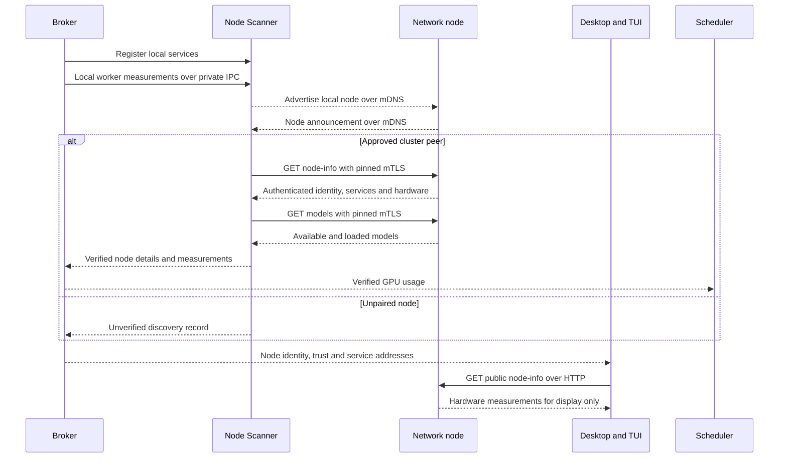

<!--
SPDX-FileCopyrightText: Copyright (c) 2026 NVIDIA CORPORATION & AFFILIATES. All rights reserved.
SPDX-License-Identifier: Apache-2.0
-->

# Microservice: Node Scanner `nvpair-node-scanner`

## 1. Purpose

The Node Scanner (Scanner for short) discovers computers on the local network and maintains a directory of their
identities, services, hardware, and models. It announces this computer, the host,
as one node, even when several services run on it. The broker distributes node
records and verified telemetry (hardware measurements) to services such as
proxies and scheduler. Desktop and the text interface (TUI) use those node
records and may read public hardware measurements separately for display.

## 2. Scope

**In scope**

- Using multicast DNS (mDNS), a protocol for local-network discovery, to announce
  a maintained list of local services (`_nvpair-node._tcp`).
- Discovery, address selection, a node directory that clients can query, and
  notifications when records change.
- Public hardware details over HTTP for frontend display, and authenticated
  details for services using approved peer nodes in the cluster.
- GPU, CPU, memory, and model enrichment: gathering extra details to add to a
  discovered node's directory record, including models loaded by each engine.
  These details are sent to broker clients, not broadcast in mDNS announcements.
- Regular telemetry reads, sample-age tracking, retries, and anti-flap behavior:
  delaying removal to avoid treating short discovery gaps as disconnects.
- Identity and trust updates while running, using saved peer certificates
  (certificate pins) to check that each peer presents the expected certificate.

**Out of scope**

- Pairing, certificate generation, membership decisions, and saving pins,
  owned by `nvpair-cluster-manager`.
- Hardware collection, owned by `nvpair-node-info`, and engine startup/model
  operations, owned by `nvpair-engine-manager`.
- Sending inference requests and choosing where to run them, owned by proxies
  and scheduler.
- Frontend network reads or cryptography, and a separate system for signing
  node details.

## 3. Key Use Cases

- **Publish this host**: the broker registers local service ports, and Scanner
  announces the host's identity, addresses in preferred order, and service ports
  as one node.
- **Discover an unpaired node**: Scanner records its mDNS announcement as an
  unverified discovery. Desktop and TUI can read public hardware details for that
  row without adding those measurements to the service directory or caches.
- **Discover a cluster peer**: Scanner verifies its node-info server against the
  saved certificate, then updates its directory record and fetches its model list
  using mTLS (mutual TLS), an encrypted connection where both nodes present
  certificates. Each checks the other's certificate against its saved pin.
- **Show live hardware usage**: desktop and TUI read public node-info for their
  hardware displays. Services read authenticated peer measurements, with a
  smaller GPU-usage message sent through the broker to scheduler.
- **Recover after a network change**: Scanner tries other known addresses and
  refreshes inventory without depending on receiving every network announcement.
- **Follow cluster changes**: Scanner reloads identity and pins when nodes join
  or leave, updating announcements and which peers can be used without a restart.

## 4. Open Questions / Risks

- **Public inventory for frontend display**: public HTTP remains a supported
  interface, including while clustered. It keeps desktop and TUI hardware
  displays available without giving either client cluster keys. HTTP does not
  verify who supplied the measurements, so those values are display data only.
  Scheduling, trust, routing, and other service decisions must use authenticated
  remote data or measurements received from a locally owned worker.
- **Unreachable does not mean removed**: a failed authenticated read may mean
  an overloaded or unreachable peer. It does not prove that the peer left the
  cluster, and an unauthenticated response cannot prove that either.
- **Service coordination**: node-info connections, shared records, broker
  caches, and service consumers must be updated together. A paired node that
  does not support authenticated inventory reads cannot supply verified details
  until upgraded. Unauthenticated data cannot be used in their place.

## 5. Requirements

**Functional**

- Scanner owns the host's network announcement. Other workers register services with
  Scanner through the broker instead of announcing separate discovery records.
- The public HTTP node-info endpoint remains available for frontend hardware
  displays, including while clustered. Its data cannot enter scheduling caches,
  verified peer records, routing inputs, trust decisions, or other service logic.
- Scanner uses mDNS identity, name, addresses, and ports to decide where to try
  connecting. Finding a pin for an advertised identity selects the certificate
  to check against, but does not prove who sent the announcement.
- Scanner marks a remote peer verified only after pinned mTLS and checks on the
  identity in its response. It uses the name, addresses, ports, and hardware from
  that authenticated response to update its record.
- The local host, verified peers, unverified discoveries, and manually configured
  servers have separate records. A claimed node identifier, a UUID, cannot cause
  unverified data to be merged into a local or verified peer record.
- Scanner refreshes inventory every 15 seconds and reads healthy node-info
  servers every two seconds with stable per-node jitter, a small fixed timing
  offset that spreads requests across nodes. Failed remote reads use backoff,
  increasing the wait: 4, 8, 16, then 30 seconds between retries, returning to the
  normal interval on success. Local reads stay at the normal interval.
- Scanner retains the last successfully read inventory during temporary failures.
  Samples retain their validity and age, including time spent in requests, queues,
  and caches. Forwarding or resending old data must not make it look new.
- Scanner sends the highest GPU utilization on each node for scheduling, using
  pinned mTLS for remote samples and private interprocess communication (IPC)
  with the local worker for local samples. Public HTTP node-info never supplies
  scheduling data, including for manually configured nodes.
- A discovery record becomes eligible for removal after 12 consecutive missed
  five-second scans. Scanner retains it when there is accepted evidence that the
  node is available. If more than one node is known and a scan returns none,
  Scanner ignores at most six consecutive empty scans before counting misses
  normally. For a paired peer, continued availability must be shown by
  authenticated inventory reads or inference responses, not just an open TCP
  port or unverified network claims.
  If a verified peer remains after its last discovery expires, Scanner continues
  checking availability during inventory refresh. After a minute without
  authenticated inventory or inference activity, Scanner removes its record and
  caches while preserving membership and saved certificates.
- Scanner applies trust changes while running. Removed or replaced pins clear
  verification status and scheduling samples, close affected connections, and
  prevent pending responses from restoring the old state.

**Non-functional**

- Scanner runs on Windows, Linux, and macOS on x64 and arm64, without administrator
  privileges.
- Request duration, response size, addresses tried, and simultaneous reads are bounded.
  A slow discovered node must not block telemetry reads from verified peers.
- Scanner has few dependencies and reuses shared discovery and cluster-trust packages.
- Tests are repeatable with simulated discovery and local HTTP/TLS test servers,
  without requiring real engines, multicast networks, or cluster membership.

## 6. Inputs and Outputs

**Inputs**: broker JSON-RPC requests over stdio (standard input/output) or `--ipc`,
mDNS announcements, local identity and pins (read only), authenticated peer
node-info responses, local hardware snapshots from owned worker IPC, model lists,
and notifications of inference responses. The broker supplies local service
ports and addresses that peers have successfully used, resending registrations
after Scanner restarts.

**Outputs**: the local mDNS record, `DirectoryNode` query results and change
notifications, node-info snapshots (measurements available at the time of a read),
smaller scheduling messages, and a startup `ready` notification. stdout carries
JSON-RPC messages written one at a time, and operational logs go to stderr.

Directory records carry `discoveryRecordId` and `identityVerification` in addition to
the existing identity, address, service, inventory, model, and `lastSeen` fields.
`identityVerification` is `local`, `pinned`, or `unverified`. These fields record
provenance: where the data came from and how the node's identity was verified.
Scanner assigns them, rather than copying them from a remote response.

`discoveryRecordId` identifies the record being tracked; `hostUuid` identifies
the host that record describes. For an unverified discovery, `hostUuid` is only
an advertised claim. Two announcements can claim the same `hostUuid` while
receiving different `discoveryRecordId` values because their service instances
or connection endpoints differ. Those distinct record IDs let Scanner track
the candidates separately while checking their claims. Neither identifier proves
ownership of a host; `identityVerification` records how identity was established.

## 7. API / Interface Contract

### 7.0 Methods and notifications

Newline-delimited JSON-RPC 2.0 over stdio by default. `--ipc <path>` selects a
Unix domain socket or Windows named pipe.

Requests (caller → Scanner):

| Method | Params | Result |
|---|---|---|
| `discovery:register` | `{service, port, txt?}` | `{ok:true}` |
| `discovery:unregister` | `{service}` | `{ok:true}` |
| `discovery:update-txt` | `{service, port, txt?}` | `{ok:true}` |
| `discovery:get-nodes` | `{service?}` | `{nodes:[DirectoryNode]}` |
| `discovery:reload-identity` | — | `{ok:true}` |
| `discovery:reload-trust` | — | `{ok:true}` |
| `discovery:set-observed-addresses` | `{addresses}` | `{ok:true}` |
| `discovery:node-activity` | `{hostUuid, msSince}` | `{ok:true}` |
| `log/set-level` | `{level}` | `{level}`, the accepted log level |
| `shutdown` | — | `null` |

Registration, identity/trust reloads, observed-address updates, and activity
reports may also arrive as notifications, messages that have no request ID and
receive no reply. `shutdown` requires a request. The broker normally sends
`discovery:node-activity` as a notification when an authenticated peer has
returned inference response data.

`discovery:update-txt` has the same handling as `discovery:register`. An empty
service name or zero port leaves the registry unchanged. Repeating a registration
or removing an absent service is also harmless: requests still return `{ok:true}`,
and unchanged registrations do not cause another network announcement.

Malformed registration, unregistration, observed-address, and activity requests
return JSON-RPC error `-32602` (invalid parameters), without changing state.
Unknown requests return `-32601` (method not found). Notifications receive no
error reply. `log/set-level` accepts `debug`, `info`, `warn`, or `error`, and
rejects an invalid level with `-32602` when sent as a request.

`discovery:get-nodes` filters by service when one is supplied. An absent, empty,
or unparseable filter returns all records. Results use a stable order.

The broker also sends `discovery:local-node-info {info}` as a notification,
carrying measurements received from its own node-info worker over private
stdio. Scanner attaches these samples to its locally owned registry record,
independently of any identity or address advertised over mDNS.

Notifications (Scanner → caller):

| Method | Payload and meaning |
|---|---|
| `ready` | `{version}`, once at startup |
| `discovery:node-discovered` | `{node: DirectoryNode}`, a new record |
| `discovery:node-updated` | `{node: DirectoryNode}`, changed identity or inventory |
| `discovery:node-removed` | `{node: DirectoryNode}`, a record removed or replaced |
| `discovery:node-info` | `{discoveryRecordId, hostUuid, clusterUuid?, identityVerification, info}`, a full hardware snapshot from pinned mTLS or owned local IPC |
| `discovery:node-telemetry` | `{hostUuid, gpuUtilizationPercent, telemetryValid, msSince}`, GPU-usage data for scheduling |

`discovery:node-info` sends a complete hardware snapshot for service consumers.
`info` includes GPU usage and video memory (VRAM), CPU, system memory, sample
validity, and age. Its `identityVerification` is `pinned` for an authenticated
remote source or `local` for an owned worker. Public HTTP display readings do
not enter this notification path or its caches.
Directory events report record changes, while snapshots report regular hardware
measurements. `lastSeen` remains the time the record last changed.

`ready` is sent before network discovery starts. It reports worker startup,
not successful advertising, peer authentication, or availability of other
services. Closing the control connection or receiving an operating-system
termination signal stops the worker. A `shutdown` request is answered before
cancellation. Malformed JSON-RPC frames are logged without ending the read loop.

Hardware sizes are in bytes and utilization is in percent. `telemetryValid`
and `msSince` describe the source GPU sample, not the age of the directory
record. When validity is false, clients ignore the age. Optional CPU, memory,
and usage fields keep their existing behavior when unavailable or omitted.

Remote scheduling measurements are sent only for verified peers. The broker
checks that the sample still belongs to the approved peer before caching or
forwarding it to scheduler. Local samples must come from owned worker IPC.
Manually configured remote nodes meet the same pin and response-identity checks;
explicit engine configuration does not authorize using public hardware data.
Without an accepted sample, existing unavailable/stale telemetry behavior applies.

### 7.1 Discovery records and trust

The mDNS TXT record format stays at version 1: `uuid` (host UUID), optional
`cluster-uuid` (the certificate principal, the node identity named in its
certificate), addresses in preferred order, and registered service ports.
Node-info reports the same certificate identity as `clusterUuid`. It identifies
the node, not a shared cluster-wide identifier. Hardware and model lists are
read from the services rather than included in TXT.

The DNS SRV (service-location) record uses the fixed port `14318`; it does not
select a service's connection port. TXT service ports identify where to try
connecting. Verified peer ports come from authenticated node-info metadata.
Unknown service keys with valid ports are retained. The TXT record lists at most
four addresses, in preferred order.

The service instance name comes from the hostname. It can help distinguish
discovery records, but cannot establish a verified host's identity. Different
hosts may use the same name.

Scanner assigns each unverified record a discovery record ID instead of identifying
it solely by its claimed host UUID. The canonical peer record, the main verified
record for an approved node, links its identity to its exact saved certificate.
Scanner checks a discovery claiming to be a known host against that link, even
when the announced certificate identity is missing or different. An announcement
cannot change which certificate belongs to a node or replace its verified
service addresses before authentication succeeds.

`trusted` is true for a verified peer whose pin is still approved. For the local
record it follows actual local membership. Adding a pin schedules authentication
of matching discoveries, rather than immediately trusting their announcements.
Unverified rows cannot be merged into member rows by matching UUID, name, or
address in the broker or either frontend.

When the user removes a peer or leaves the cluster, the affected verified peer
records disappear from the broker's desktop and TUI views. A later mDNS
announcement may appear as a separate unverified discovery. An unverified
discovery or a saved manual configuration cannot preserve the removed peer's
verification.

### 7.2 Inventory and model transport

Node-info serves `GET /v1/node-info` on its registered `ni` port (normally
`14318`) with a shared split listener, which accepts both HTTP and mTLS on the
same port:

| Reader | Transport | Use of the response |
|---|---|---|
| Desktop or TUI hardware display | Public, unencrypted HTTP, including while clustered | Unverified hardware details for display only |
| Service reading an approved remote peer | Existing certificate-pinned mTLS | Authoritative peer metadata and telemetry |
| This host's services | Private broker/worker IPC | Locally owned inventory and scheduling measurements |

Public HTTP is an ongoing frontend display interface. It is independent of the
authenticated service path, and this specification does not require moving
desktop or TUI hardware polling into the broker. Discovery and pairing use the
addresses and service ports supplied by mDNS and do not require hardware previews.
The split listener keeps public HTTP available while live membership gates the
peer node inventory handler. Neither plaintext HTTP nor TLS without a
matching peer pin can supply authenticated remote data to services.

Local hardware reads use private IPC to keep a consistent source rule for service
measurements: local data comes from an owned worker, and remote data requires
pinned mTLS. IPC ties local measurements to the node-info process started by the
broker, rather than whichever process answers a local HTTP port. This avoids a
special exception allowing services to read hardware over HTTP only on loopback.

Node-info publishes `nodeinfo:info-updated {info}` over its owned
stdio channel at startup and every two seconds. The broker forwards those
snapshots as `discovery:local-node-info`, adding elapsed time to sample age when
forwarding or replaying cached data. The public listener remains available to
frontend displays. A discovered record must not be treated as local merely because
its advertised address points to this computer, including a loopback address such
as `127.0.0.1` or `::1`.

The mTLS request handler checks current membership and requires the client's
certificate to match its saved pin exactly on every request, including reused
connections. Scanner checks the server's certificate the same way, and checks
that response `hostUuid` and `clusterUuid` match the node UUID in that certificate
and the approved node identity. Keeping a certificate and private key after
leaving a cluster does not keep the authenticated endpoint available.

Scanner uses the record's current address list for each read. It remembers a
successful address separately for node-info and engine-manager. If that address
stops answering or is removed from the list, Scanner tries the other addresses.
Among successful alternatives, it chooses the first in the record's order.
Unverified candidates cannot replace a verified peer's remembered address or
supply addresses used as evidence to choose this host's own address.

The peer node inventory response includes the existing hardware fields and a `peer`
object containing the serving host's name, addresses in preferred order, and
registered service ports. These details come from its own local Scanner registry,
the list of services registered on that host:

```json
{
  "peer": {
    "name": "workstation-b",
    "addresses": ["192.0.2.20"],
    "services": {"ni": 14318, "ol": 11434, "em": 14322}
  }
}
```

The broker sends the local snapshot to node-info over stdio using
`nodeinfo:set-peer-metadata {hostUuid, clusterUuid, peer}`, with result
`{ok:true}`. It refreshes the snapshot after local identity, name, address, or
registration changes and resends it on restart. Peer node inventory is served
only when the snapshot agrees with the current cluster identity. Until
setup is complete, or while identity is changing, it returns `503`, while public
hardware inventory remains available.

Peer node-info responses must fit within 65,536 bytes; Scanner rejects larger
responses. This limit applies to the authenticated service interface.

For an approved peer, a failed pin check, TLS exchange, or identity validation
never triggers a retry over unencrypted HTTP. For public responses, absent
`clusterUuid` means unknown and an empty value is an unclustered claim, neither
of which changes an established peer's membership or verified data.

Scanner reads a peer's models using the verified engine-manager (`em`) service
details and `GET /v1/models` over pinned mTLS. For the local host, Scanner uses
its own registry and unencrypted HTTP over loopback. It adds the combined model
list, `modelsByEngine`, and `loadedByEngine` to the directory, retaining the last
successfully read data during temporary failures. A newly authenticated peer
schedules a model refresh without waiting for the next periodic inventory sweep.

Scanner compares model lists without depending on their order. A present engine entry
with an empty list reports no models for that engine; a missing entry means
no inventory was supplied for it. Omitted per-engine maps leave the combined
model list available without supplying per-engine details.

Hardware and model updates preserve each other's fields. Scanner accepts a result
into records or caches only while the target record, the service's address and port,
and its approved identity are still current. A result for a removed or changed
target cannot restore old data, even if the network request succeeded.

### 7.3 Frontend display and service decisions

Desktop's `node-info-poller.ts` reads node-info over HTTP. TUI's
`nodetelemetry.go` also uses HTTP for node detail screens. These display reads
remain supported for local, paired, unpaired, and manually configured nodes.
They preserve GPU, VRAM, CPU, and memory displays without frontend certificate
handling or a required switch to broker-delivered hardware snapshots.

Scanner sends its directory changes directly to the broker. `discovery:subscribe`
is a broker method, not a Scanner method. Subscribed workers receive all records
matching their requested services in `discovery:nodes`; subscribed desktop and
TUI clients receive full snapshots in `discovery:nodes-changed`. Consumers
replace their previous set with each snapshot rather than treating it as a list
of individual changes.

Both clients continue to receive node identity, trust state, service addresses,
and model records from the broker. HTTP measurements may update hardware display
fields only. Reported identity or membership fields are unverified claims and
cannot change the broker's trusted records or be sent back as authoritative
service input. A node's identity can be verified while its HTTP display readings
remain unverified.

Removing an unverified discovery, including when it is replaced by a verified
record, does not mean the verified peer departed. Removing a manual configuration
cannot remove an independently verified peer record. Membership or pin removal
still clears the affected verification, regardless of other discovery or manual
records that remain.

Scanner, manual-node workers, broker caches, scheduler, proxies, and other
services must not use public node-info responses for their decisions. Remote
node-info reads use pinned mTLS; local measurements use owned worker IPC. A
manually entered address can be a connection candidate, but hardware data must
still authenticate before it is used by services. Public HTTP measurements
cannot be used to select engines, change routing, prove peer availability or
membership, or populate scheduling caches.

An authenticated read failure leaves service data unavailable or aging according
to the existing freshness rules. It never causes a service to fall back to public
HTTP, even if a frontend can still display a public response from that node.

### 7.4 Contract evolution

Changes to snapshot notifications and identity-verification fields are coordinated
across shared Go types, broker forwarding and caches, proxies that read the
directory, desktop bridge, and TUI. Discovery method names and the mDNS record
format remain stable. Operator TLS settings cannot replace exact certificate-pin
checks for an approved peer.

The TXT schema describes the advertised fields and their meanings. The new
discovery record IDs and verification fields belong to the JSON-RPC contract;
they do not change the meaning of `uuid=` or require a different TXT format.

## 8. Dependencies

- **Broker**: `nvpair-ui-broker` starts and supervises Scanner and registers local
  services.
- **Cluster manager**: `nvpair-cluster-manager` maintains node identity and trusted
  certificate pins.
- **Reads data from**: node-info and engine-manager. The broker distributes its
  results to frontend clients, proxies, and scheduler.
- **Shared packages**: `nvpair-shared/noderec`, discovery/address helpers,
  `clustertrust`, JSON-RPC, and `applog`. No additional trust service or keys.

## 9. Data Ownership

- **Owned**: the local service list, discovery directory, unverified records,
  information used to choose addresses, request/retry state, and cached inventory
  and measurements. These are kept in memory for the current session.
- **Source of truth**: local registry for this host's advertised services,
  cluster-manager for membership/pins, node-info for hardware samples, and
  engine-manager for model lists. Scanner builds its directory from these sources.
- **Storage**: Scanner reads existing identity/trust state. It adds no persistent
  discovery database, pin writes, or cryptographic identity files. It uses existing
  node-ID resolution, which may create `node-id.json` before cluster-manager
  supplies an identity. When the local UUID changes, Scanner retires the old local
  record so clients do not retain both identities.

## 10. Design Constraints

- **Performance**: Scanner keeps discovery and two-second telemetry responsive by
  limiting simultaneous reads. Nodes awaiting authentication have separate
  identity and retry state from verified peers. Requests and response sizes are bounded.
  Waiting behind another node-info read must not consume a request's own timeout
  budget. Model-request deadlines allow engine-manager's bounded inventory
  collection to finish.
- **Reliability**: Scanner refreshes without new mDNS announcements, tries addresses
  in preferred order, and retains previously read data with its correct age. Failed
  discoveries cannot replace a peer's last verified address or interrupt its reads.
  Scanner reconsiders local addresses periodically and after network changes. The
  broker's observed-address list, addresses that peers have reached on this host,
  replaces the previous list so withdrawn observations stop influencing selection.
- **Security**: services use existing pin-based mTLS in Go. Verifying one
  connection does not verify unrelated unencrypted data or every address in an
  announcement. Scanner rechecks the approved node identity and exact pin before
  accepting a response.
- **Transport**: one registered node-info port supports public frontend display
  and peer node inventory over pinned mTLS. Public HTTP data is for display only;
  service logic uses pinned remote reads or private local IPC. No additional advertised
  port or frontend key handling is required.

## 11. Assumptions

- The broker owns the Scanner control connection and starts/stops local workers.
- Unapproved nodes can announce themselves. They can read public hardware
  inventory for display, including while the serving node is clustered.
- Authenticated peers can report their own details. Authentication proves which
  node sent them, but cannot prove that a compromised approved node reports
  truthful measurements.
- Local cluster state controls membership. Network reachability alone does not.

## 12. Failure Modes and Mitigations

| Failure | Behavior |
|---|---|
| Missing or malformed announcement | Unusable fields are ignored; usable unverified data is retained within discovery limits |
| Peer authentication or identity mismatch | The discovery is not marked verified, the existing peer record is unchanged, and no unencrypted retry occurs |
| Inventory/model timeout or unreachable peer | Previously read inventory is retained, measurements age, and retries use increasing intervals up to the limit |
| Pin removal/replacement or local departure | Verification is cleared, affected connections close, routing stops using the peer, and scheduling samples are discarded |
| Response arriving after a trust change | The response is discarded before records are updated or telemetry is sent |
| Unverified UUID/name/address collision | Discovery and configuration records remain separate and cannot overwrite local or verified data |
| Worker restart | The broker resends local registrations/details, remote records are authenticated again, and cached sample age is preserved |
| Peer node inventory or local worker unavailable | Service measurements become unavailable/stale, no fallback to public HTTP |
| Public HTTP read fails | Frontend measurements become unavailable/stale, authenticated service reads remain independent |
| Public HTTP data enters a service cache | The data is rejected based on source, including public data attributed to manual nodes |
| Local network advertising unavailable | Scanner logs the failure and continues browsing and maintaining the local record |
| Temporary failure to read saved peer pins | A failed read does not count as removal of every peer pin |

The local announcement follows current identity and membership. A remote peer
does not lose its approved membership merely because its authenticated endpoint
stops answering. After a removal is processed, an old response or still-open
connection cannot restore its former trust.

## 13. Observability

- **Logging**: logs contain structured operational details on stderr, including
  service, node or discovery record ID, authentication outcome, retries, and
  directory changes. Key material, certificates, pairing PINs, prompts, and
  response bodies are never logged.
- **Freshness**: snapshots report whether samples are usable and how old they are.
  Resending a sample never reduces its age. Failed reads must not make a node
  appear freshly measured with zero usage.
- **Events**: clients receive notifications when directory data changes. Seeing
  the same announcement or reloading unchanged trust data does not send another update.

## 14. Example runtime flow

The broker starts Scanner, registers the local service ports, and receives its
directory and telemetry notifications. Scanner announces this host and listens
for other nodes on the local network. Unpaired nodes appear in discovery rows.
Approved peers are authenticated before their details enter verified records.



The diagram shows separate display and service paths. HTTP display readings
never flow into scheduler or verified peer records. Service inventory refreshes
every 15 seconds and measurements every two seconds, independently of mDNS
changes. The broker forwards trust changes to Scanner and clears affected
verification and service samples when membership or pins change.
